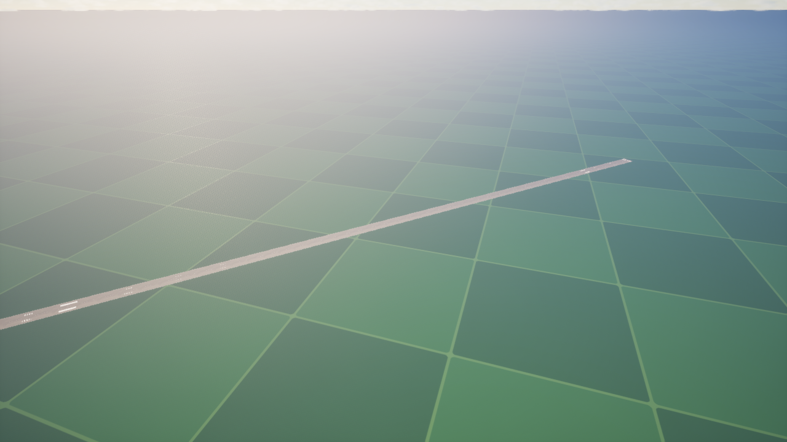

# JSBSim F16 专用试飞关卡

更新：2026-10-28。

关卡：`/Game/Levels/Tests/L_JSBSimFlightTest`。在 Content Browser 的 `Levels/Tests` 中打开并 Play，默认从跑道地面起始。
原有编辑器启动关卡、全局 GameMode、F16 资产和飞行 / 输入 / 相机配置均保持原样。

## 地面与空中测试

| PlayerStartTag | 地点 | 初始状态 |
|---|---|---|
| Ground | 跑道起端内约 150 m，Actor 原点 Z≈2.1712 m（坐标迁移后） | 地面配平、0 节、起落架放下 |
| Air | 跑道起端后方 5 km，Actor 原点本地 Z≈2998.1712 m（原飞行高度保持），沿跑道航向 | 全状态空中配平、400 节、起落架收起 |

跑道航向为 UE Yaw 约 -47.35°。地面配平会根据现有 F16 接触点调整最终 Actor 位置；PlayerStart 并非轮胎接触点。
原点海拔为 19 m；空中起点的实际 ASL 约 3021 m，AGL 由场景碰撞面计算。

PIE 中打开控制台，切换空中起始：

```text
open /Game/Levels/Tests/L_JSBSimFlightTest?FlightTestStart=Air
```

返回地面：

```text
open /Game/Levels/Tests/L_JSBSimFlightTest?FlightTestStart=Ground
```

这会重新载入测试关卡并初始化飞机。也可在 `BP_JSBSimFlightTestGameMode` 的 Class Defaults 中修改 `DefaultStartTag`，
将常用的编辑器 Play 起始模式设为 Air 或 Ground。选择 PlayerStart 或 Play From Here 不用于切换配平模式。
可在两个 `FighterFlightTestPlayerStart` 实例上调整位置、朝向及空中初始速度。

## 场景与资源

环境源自本地 `jsbsim/UnrealEngine/Content/Levels/StartupLevel`。仅迁入 11 个环境资产，集中在
`/Game/Assets/Environment/JSBSimReference`，没有带入示例飞机、输入、相机、PFD、机型选择器、关卡蓝图或旧飞行插件。

- 地面：`Terrain/SM_Terrain`，约 100 × 100 km 的平面 Static Mesh；保留原网格材质及网格函数。
- 跑道：`Terrain/Runway/SM_Runway`，约 3350 × 60 m；保留原摆放、比例及标线。
- 地面与跑道实例均使用 WorldStatic / BlockAll，网格使用 Complex As Simple，所有 LOD 分段启用碰撞。
  地面可见表面在本地 Z≈-5 cm，跑道表面在 Z≈0；通过复开地图后的复杂碰撞射线验证。
- 跑道使用新建 `M_Runway_Surface` 和 `MI_Runway_Asphalt`：原 D/N/ORDp 贴图分别驱动 BaseColor、Normal、AO(R)、Roughness(G)。
  ORDp 的位移通道不启用。旧材质实例已删除，避免旧缓存携带 Bridge 资源；完整环境依赖不包含 Bridge、MSPresets 或 SunPosition。
- 天空从现有 `test_fighter` 复制：DirectionalLight、SkyLight、SkyAtmosphere、ExponentialHeightFog、VolumetricCloud，保留其属性。
  不引入 SunSky 或 SunPosition 插件。

GeoReferencing 使用示例的 RoundPlanet、WGS84/EPSG:4326，原点纬度 45.461075、经度 -73.765021、海拔 19 m。
ProjectedCRS 保留 EPSG:32631；当前使用地理原点与 ECEF 转换，它不是该场景启用的投影定位方式。
这是球面坐标中的局部平面测试地面，不是真实高程地形；远距离的 ASL 会随地球曲率变化，应以碰撞查询的 AGL 判断离地高度。
本关卡禁用 World Bounds Checks；单一静态测试地面常驻，不使用 World Partition 或示例关卡逻辑。

## 出生职责

`BP_JSBSimFlightTestGameMode` 仅在新关卡的 World Settings 中覆盖 GameMode。
它继承 `AFighterFlightTestGameMode`，沿用原 GameMode 的 Controller / HUD / GameState / PlayerState / Spectator 类，
默认 Pawn 明确指向现有 `BP_F16A`。

`AFighterFlightTestGameMode` 按 `FlightTestStart` URL 选项或 `DefaultStartTag` 选择标记的 PlayerStart。
未识别的选项会记录警告并回退到默认起点。通过 deferred spawn，在 FinishSpawning 之前设置
`AFighter::ConfigureStartState` 与本次出生的起落架状态，保证 `PostInitializeComponents` 和 JSBSim BeginPlay / DoTrim 读取正确初始条件。
此接口拒绝初始化完成后的调用；运行中的飞机切换起始模式应重新载入关卡。

关卡没有预放置 Fighter，每次只生成一架并由现有 PlayerController 操纵。
测试 GameMode 不参与每帧飞控、动力学、动画或相机更新，不改动 120 Hz 时钟、显示插值、结构原点映射或 F16 XML。

## 验证

- AirCombatEditor / Win64 / Development 完整构建成功。
- 原有 AirCombat 自动化测试 27/27 通过，0 失败、0 警告、0 跳过。
- 保存后重新加载，检查环境依赖闭包与四个地面查询点：跑道起端、跑道中部、跑道外地面、远处地面。
- 实际 PIE：默认 Ground → URL 切换 Air → URL 返回 Ground，均成功配平并仅生成一个 BP_F16A。
- Ground / Air 各自以受控 30、60、144、240 FPS 运行，共 8 组检查通过；受控区间无新增丢时，最终相机缓存与相机组件同步。
- 逐帧核对现有视觉标定、相机、模型名称、StructuralFrameOrigin；迁移前后原有 Content、Config 与 F16 模型资源文件哈希一致。

固定帧率验证使用 NullRHI 的游戏帧时间控制，验证的是仿真和变换同步，不代表实测 GPU 帧率或长期飞行稳定性。
详细结果见 [validation.json](validation.json)。新关卡没有加入默认启动地图或打包地图列表；如需独立打包试飞场，应显式将此地图加入打包配置。

环境来源许可见 [JSBSimReference-LICENSE.txt](JSBSimReference-LICENSE.txt)。

实际渲染器下的场景检查图：




## 2026-10-28 出生点坐标迁移

Actor 原点已统一为 Mesh 原点，三个 PlayerStart 按各关卡默认 F16 的旧 Mesh 偏移换算，
保持原始物理 CG 和视觉飞机出生位置。出生点现在表示模型原点，不是 CG 或胎面接地点；
不应因为标记低于地面就额外抬高一次。当前变换和验证见 [结构原点迁移](../VisualAlignment/StructuralOrigin/validation.json)。
替换其他机型后应按新模型的原点和物理初始条件选择合适测试位置，GameMode 不再叠加机型偏移。
