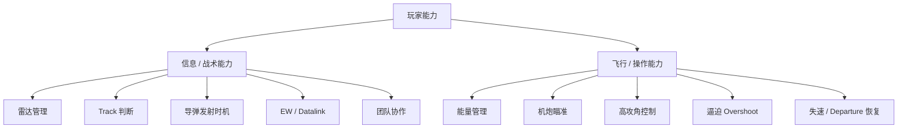
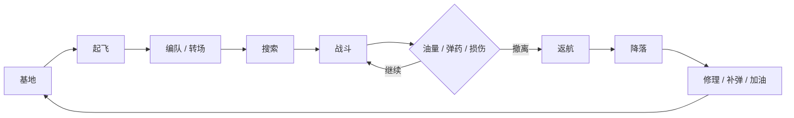

# 01 — 核心玩法与产品基调

## 1. 基础基调

游戏定位为：

> **半拟真 / Sim-lite**

它位于：

```text
硬核学习型飞行模拟
        ↕
      本项目
        ↕
纯街机空战游戏
```

之间。

玩家应该明显感觉飞机遵守物理规则，但不需要完成真实飞行员那种复杂程序操作。

我们希望玩家：

> **理解现代空战为什么有意思，而不是先学会怎么做飞行员。**

---

## 2. 两条独立技能树

游戏必须同时奖励两种能力。



一个优秀战术玩家应该能创造优势局面。

一个优秀飞行玩家应该能把困难局面打回来。

真正顶尖的玩家需要两者兼备。

---

## 3. 战斗节奏

游戏不应该一直处于开火状态。

理想节奏：

```text
安静搜索
   ↓
发现模糊接触
   ↓
Track 逐渐建立
   ↓
确认威胁
   ↓
导弹发射
   ↓
RWR 告警 / 防御
   ↓
Merge
   ↓
激烈狗斗
   ↓
飞机受损
   ↓
脱离
   ↓
返航
```

“安静”和“爆发”之间的反差，是空战紧张感的重要来源。

---

## 4. Sortie 是一个完整玩法单位

不希望形成：

```text
出生
↓
冲过去
↓
死
↓
3 秒复活
```

更希望：



起飞和返航要有意义，但不能拖沓。

首版目标：

> 正常情况下起飞后约 2–4 分钟进入有意义的接敌阶段。

---

## 5. 损伤系统应该制造故事

不要只有：

```text
HP 100 → 0
```

更希望有：

- 控制面损伤；
- 发动机损伤；
- 漏油；
- 雷达损伤；
- 传感器失效；
- 电气系统问题；
- 起落架损伤；
- 结构损伤。

重点不是工程级仿真。

重点是：

> **受损以后，玩家面对的是一个新的驾驶与战术问题。**

例如：

```text
右发动机损坏
↓
不对称推力
↓
飞机持续偏航
↓
玩家使用 Rudder / Trim 把飞机带回去
```

---

## 6. 返航本身就是玩法

玩家必须经常面对：

```text
继续追杀
    VS
保住飞机返航
```

可能结果：

- 正常返航；
- 紧急迫降；
- 弹射；
- 飞机损失；
- 玩家死亡。

不需要做成极端惩罚性的 Persistent Campaign。

只需要让：

> **“活着把飞机带回来”有意义。**

---

## 7. 弹射

弹射不应该只是死亡动画。

可以表现为：

```text
飞机不可控
   ↓
EJECT
   ↓
座舱盖脱离
   ↓
弹射座椅
   ↓
降落伞
   ↓
看着自己的飞机坠毁
```

战绩可以区分：

```text
Aircraft Lost / Pilot Survived
Aircraft Lost / Pilot Lost
```

---

## 8. 涌现式任务，而不是任务提示驱动

优先让系统自己制造任务。

例如：

```text
敌方正在攻击 AWACS
      ↓
己方 Datalink 开始恶化
      ↓
玩家自然回防
```

不需要强制弹：

```text
NEW OBJECTIVE:
DEFEND AWACS
```

理想状态是：

> **游戏世界自己告诉玩家什么事情值得做。**

---

## 9. 新手到高手的成长路径

### 新手

能完成：

- 飞行；
- 开炮；
- 使用基础雷达；
- 理解导弹警告；
- 放干扰弹；
- 返航。

### 中级玩家

开始理解：

- BVR 发射窗口；
- Radar Mode；
- 油量；
- 能量；
- Datalink；
- 攻击几何。

### 高手

开始利用：

- 雷达静默；
- 地形遮蔽；
- Rudder；
- 高 AoA；
- Post-stall；
- Overshoot；
- 特殊挂载；
- 带伤返航；
- 团队传感器网络。

设计原则：

> **复杂度应该逐渐暴露，而不是从游戏里删除。**
