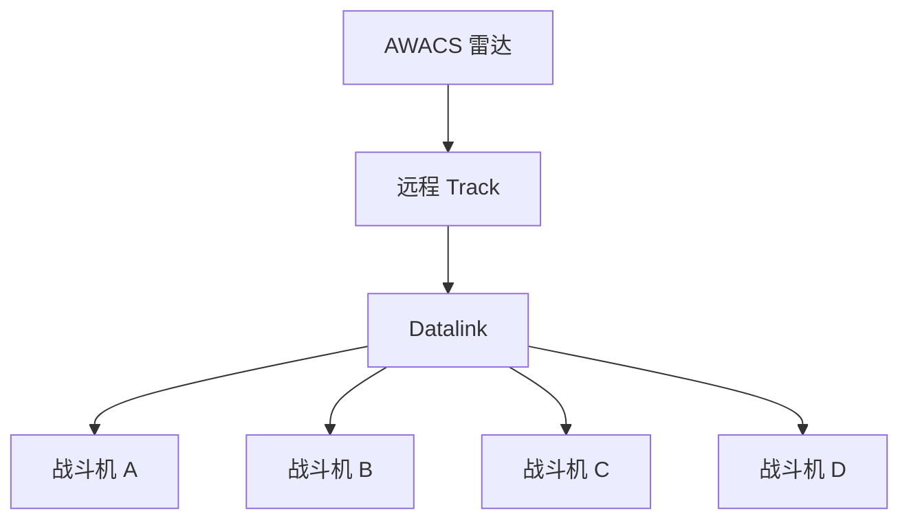

# 02 — 武器、雷达、传感器与空战

## 1. 三层空战距离


战斗可以自然从远距离逐步进入近距离。

---

# A. 机炮系统

## 2. 炮弹不是通用刚体

不要每一发创建：

```text
RigidBody
Collider
Network Actor
Physics Proxy
```

使用紧凑状态：

```cpp
struct GunProjectile
{
    Vec3d position;
    Vec3d velocity;
    float age;
    uint32_t owner;
    uint32_t ammoType;
    uint32_t flags;
};
```

统一批量更新。

---

## 3. 碰撞

高速炮弹必须避免 Tunnelling。

流程：

```text
oldPosition
   ↓
积分弹道
   ↓
newPosition
   ↓
Segment / Sphere Sweep
   ↓
命中 / 继续
```

使用：

- Ray Segment；
- 小半径 Sphere Cast / Sweep。

---

## 4. 基础弹道

\[
p_{t+\Delta t}=p_t+v_t\Delta t
\]

\[
v_{t+\Delta t}=v_t+g\Delta t
\]

炮弹初速度：

\[
V_{bullet}
=
V_{aircraft}
+
R_{aircraft}V_{muzzle}
\]

以后可以增加阻力。

---

## 5. 曳光弹

曳光弹不是另一套“假轨迹”。

它就是正常炮弹：

```text
Round 100
Round 101
Round 102 ← Tracer
Round 103
```

Renderer 直接读取真实弹道状态：

- previousPosition；
- currentPosition；
- velocity；
- emissive；
- bloom。

因此：

> **玩家看到的曳光轨迹，就是实际炮弹轨迹。**

---

## 6. 机炮瞄准 UI

建议基础元素：

```text
○ 目标位置
◉ 提前量
+ 固定枪线 / Boresight
```

玩家必须操纵整架飞机，让：

```text
+
```

靠近：

```text
◉
```

而不是像 FPS 一样自由移动枪口。

---

## 7. 提前量预测

目标可使用：

\[
P(t)=P_0+Vt+\frac12At^2
\]

HUD 预测和真实炮弹必须使用同一个 Ballistic Model。

不要出现：

```text
HUD 弹道算法
≠
真实炮弹算法
```

目标突然改变机动时，提前量应该失效。

这本身就是技术含量。

---

# B. 导弹系统

## 8. 首批导弹 Archetype

首版不需要很多型号。

只需要：

| 类型 | 核心玩法 |
|---|---|
| 近距 IR | 被动搜索、高机动、狗斗 |
| 主动雷达弹 | BVR、中段支撑、末段主动 |
| 半主动雷达弹 | 持续支撑要求高 |
| 超远程雷达弹 | 战略武器、高价值目标 |

现实型号只作为灵感。

游戏不依赖不可靠或敏感的真实参数。

---

## 9. 主动雷达导弹阶段


真正好玩的部分是：

> 导弹还没有 Active 时，发射方是否继续支撑。

如果敌方导弹正在飞来，玩家会面对：

```text
继续支撑自己的导弹
       VS
立刻防御
```

---

## 10. 导弹能量

不要：

```text
Range < X
→ 必定能追到
```

导弹应考虑：

- 发射速度；
- 发射高度；
- 发动机燃烧；
- 阻力；
- 转向损失；
- 滑翔；
- 目标运动方向。

这样玩家会自然理解：

> **高度和速度就是资源。**

---

## 11. 发射窗口

HUD 可以显示大致：

```text
MAX RANGE
──────────

GOOD SHOT
───────

STRONG ZONE
────

TARGET
```

或者：

```text
LOW
MEDIUM
HIGH
```

不要显示：

```text
Kill Probability = 83.72%
```

这种虚假精确度。

---

# C. 雷达与 Track

## 12. 探测不是 Boolean

不要：

```text
distance < 100 km → detected
```

使用：

```text
Undetected
   ↓
Possible Contact
   ↓
Uncertain Track
   ↓
Stable Track
   ↓
Fire-Control Quality
```

影响因素：

- 距离；
- Aspect；
- 相对雷达特征；
- Radar Mode；
- LOS；
- 地形；
- 目标机动；
- Jam；
- Scan Revisit；
- 传感器性能；
- 外部 Datalink Track。

---

## 13. Radar Mode

### Search

- 扫描范围大；
- 更新慢；
- 发现更多目标。

### TWS

- 维护多个目标；
- 支持主动雷达弹；
- 保持较大态势范围。

### STT

- 强关注单一目标；
- 更新更快；
- Track 更稳定；
- 对方更容易意识到被重点跟踪。

重点是：

> 模式切换制造决策，而不是制造按键负担。

---

## 14. RWR

RWR 应该快速表达：

- 威胁方向；
- 威胁来源；
- 当前状态。

简化状态：

```text
SEARCH
   ↓
TRACK
   ↓
HIGH THREAT / MISSILE
```

声音提示非常重要。

---

## 15. 红外与被动搜索

红外系统可以依赖：

- 发动机功率；
- Afterburner；
- Aspect；
- 距离；
- 背景；
- Seeker FOV。

IR 和 Radar 必须让玩家感觉到完全不同。

---

# D. 反制与电子战

## 16. Flare / Chaff 不是概率按钮

不要：

```text
Press Flare
→ 50% Miss
```

而是让 seeker 在多个候选中判断。

IR：

```text
Aircraft
Flare
Flare
Flare
```

Radar：

```text
Aircraft Track
Chaff
Jamming
Geometry Change
```

内部算法可以简化，但结果来自 Tracking / Seeker 逻辑。

---

## 17. EW

电子战的主要效果应该是：

> **破坏信息质量。**

而不是：

```text
Enemy Accuracy -30%
```

例如：

```text
正常：
•    •      •

被干扰：
?   .?.     ?
```

可能表现：

- Track Quality 降低；
- Track 建立更慢；
- 身份判断变差；
- 位置误差增大；
- Track 暂时丢失。

---

# E. 数据链与 AWACS

## 18. Datalink

队伍信息可能来自：

- 自己雷达；
- 队友雷达；
- 地面雷达；
- AWACS；
- 被动传感器。

玩家可以：

```text
Radar OFF
+
Datalink ON
```

依靠别人提供信息。

---

## 19. AWACS

AWACS：

> **Airborne Warning and Control System，空中预警与指挥系统。**

游戏里它不是 Buff。

它是真实存在于地图上的长距离传感器与信息节点。



AWACS 被击落后：

- 团队远程态势感知下降；
- Radar Silent 战术难度提高；
- Stealth Threat 变得更危险。

---

# F. 五代机与隐身

## 20. Stealth ≠ Invisible

隐身应该改变探测链：

```text
远：
Undetected

接近：
Intermittent Contact

更近：
Uncertain Track

再近：
Stable Track
```

游戏内部使用相对 Signature。

不要依赖真实机型未公开或争议性的 RCS 数据。

---

## 21. Sensor Fusion

五代机的重要优势：

```text
Radar
+
IRST
+
RWR / Passive Emitter
+
Datalink
+
AWACS
        ↓
Unified Track
```

先进飞机并不一定应该更复杂。

相反：

> **先进航电可以替玩家处理更多信息。**

---

## 22. 隐身设计原则

> **Stealth 帮你选择什么时候进入战斗，但不能替你赢下战斗。**

近距离以后：

- 目视；
- IR；
- 能量；
- 机动；
- Pilot Skill；

重新成为核心。

---

## 23. 内挂与外挂

### 内挂模式

- Signature 更低；
- Drag 更低；
- 武器数量有限。

### 外挂模式

- 武器更多；
- 油更多；
- Drag 增加；
- Signature 增加。

同一架五代机因此可以有完全不同的任务状态。
