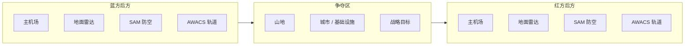

# 03 — 对局、地图、机场与胜负目标

## 1. 首个多人原型

当前建议：

- **8v8**
- 地图约 **160 km × 160 km**
- 对局约 **30–40 分钟**
- 起飞后约 **2–4 分钟**出现第一轮真正接敌

这只是首版测试基线。

---

## 2. 机场位置

机场不要贴地图边缘。

建议：

```text
地图边缘
  ↓
20–25 km
  ↓
BLUE BASE
  ↓
50–70 km
  ↓
核心争夺区
  ↓
50–70 km
  ↓
RED BASE
  ↓
20–25 km
  ↓
地图边缘
```

两个主基地间距：

> **约 120–140 km**

而且不要完全水平镜像。

适当错位会产生更多路线。

---

## 3. 战区示意



地图地形必须参与战术：

- 山区 → Radar Masking；
- 平原 → 远距离雷达更强；
- 海岸 → 提供侧翼路线；
- 山谷 → 低空渗透。

---

## 4. 开局 Rush / 机场屠杀问题

不能靠：

- 空气墙；
- Safe Zone；
- 禁止开火区域。

解决原则：

> **机场可以打，但开局强冲机场不是最佳策略。**

---

## 5. 天然基地防御

机场周边：

```text
敌方方向
   ↓
Ground Radar
   ↓
Long / Medium SAM
   ↓
Short Range Defence
   ↓
Airbase
```

强冲基地会：

- 被提前发现；
- 进入己方完整传感器网；
- 被 SAM 威胁；
- 被拦截机包围；
- 消耗大量燃油。

如果玩家真的组织好一次 Deep Strike，则应该允许成功。

---

## 6. 机场可以受损

### 雷达设施损伤

- 基地区域感知下降。

### 油料设施损伤

- Refuel / Rearm 时间增长。

### 跑道损伤

- 某段暂时无法使用。

### 机库 / 支援设施损伤

- Repair / Respawn 时间增加。

原则：

> 攻击机场要有实际价值，但不能导致失败方完全无法继续游戏。

---

## 7. 多起降点

可以考虑：

- 主机场；
- Forward Airstrip；
- 多跑道；
- 某些地图加入航母。

这样可以避免一处被压制就彻底失去作战能力。

---

## 8. 胜负不是单纯 Kill Count

整场比赛代表一次压缩的小型 Air Campaign。

双方拥有：

```text
战斗机
AWACS
Ground Radar
SAM
Airbase
Fuel / Support
```

真正目标：

> **让对方逐渐失去维持有效空中作战的能力。**

---

## 9. Operational Strength

UI 可以显示：

```text
BLUE AIR CONTROL ███████░░░ RED
```

但它只是摘要。

实际变化来自：

- 飞机损失；
- AWACS 损失；
- 雷达网络损伤；
- 基地损伤；
- 战略目标完成。

---

## 10. 支援单位是真实系统

### AWACS

提供：

- 长程 Track；
- Datalink；
- 战区态势。

### Ground Radar

提供：

- 区域性覆盖；
- 低空目标一定程度探测；
- Fighter Track 支援。

### SAM

作用：

- Area Denial；
- 基地保护；
- 强迫敌人改变路线。

这些单位不是加分道具，而是改变世界规则的系统。

---

## 11. 战场会逐渐退化

### 前期

```text
AWACS ✓
Radar ✓
Fuel 高
导弹充足
信息丰富
```

### 中期

```text
部分雷达受损
玩家分散执行任务
开始 Deep Strike
部分玩家返航
```

### 后期

```text
信息网络残缺
燃油不足
远程弹减少
WVR 增加
受损飞机增加
```

整局自然从：

> 信息战

逐渐变成：

> 越来越近、越来越原始的空战。

---

## 12. 没打中的导弹也可能是成功攻击

敌方为了躲导弹：

- Defensive Turn；
- Dive；
- Burn Fuel；
- 放弃目标；
- 队形分散；
- 失去 Radar Support。

即使导弹 Miss：

> 战术上也可能已经获得优势。

---

## 13. 8v8 地图基础配置

每边建议：

- 1 个主机场；
- 1 个前进 / 次级起降点；
- 1 架 AWACS；
- 2–3 个 Ground Radar；
- 2–4 个 SAM Group。

中央地图：

- 山区；
- 平原 / 城市；
- 海岸 / 水域；
- 2–3 个战略目标。

首版已经足够形成丰富战术。
