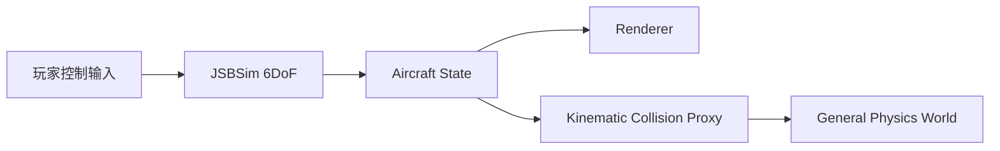
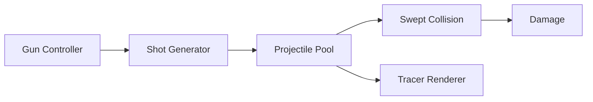

# 06 — 技术架构

> 实现现状（2026-10-27）：当前工程使用 UE 5.8.3，Windows RHI 为 DX12。
> 下文自研引擎 / Vulkan 部分保留为早期方案，不代表当前实现。
> 输入实现见 [Input](../Input/README.md)，相机采用 SpringArm + CameraComponent，详见 [Camera](../Camera/README.md)。
> 模型和相机共用 PresentationRoot 插值姿态，Airframe 使用单位变换、视觉锚点使用 Mesh 坐标，StructuralFrameOrigin 保存唯一平移标定，动态 CG 仅作物理参考标记；F16 整体标定及保留的几何差异见 [VisualAlignment](../VisualAlignment/README.md)。

> 最新固定步进与显示更新顺序见 [Presentation](../Presentation/README.md)。

## 1. 基础技术栈

当前方向：

- 自研 C++ Engine；
- Vulkan Renderer；
- 自研 General Physics；
- JSBSim Aircraft Flight Dynamics；
- Dedicated Authoritative Server。

---

# A. 飞机物理归属

## 2. JSBSim 拥有飞机动力学状态

推荐结构：



JSBSim 负责：

- Position；
- Orientation；
- Linear Velocity；
- Angular Velocity；
- Aerodynamics；
- Propulsion；
- Flight Control。

---

## 3. 不允许两个动态 Solver 同时控制飞机

避免：

```text
JSBSim
   ↓
Aircraft State

同时

General RigidBody Solver
   ↓
Aircraft State
```

会导致：

- Jitter；
- Solver Fighting；
- 能量错误；
- 不稳定。

所以飞机在通用物理世界里主要作为：

> **Kinematic / Query Proxy**

---

## 4. 通用物理系统负责

- 地面车辆；
- 建筑；
- Debris；
- Props；
- 碰撞检测；
- Crash Detection；
- 世界其他刚体。

飞机动力学仍归 JSBSim。

---

# B. 地面接触与起落架

## 5. Landing Gear / Ground Reaction

JSBSim 有 Ground Reaction。

Host Engine 提供：

```text
Gear Contact Point
   ↓
Terrain / Physics Query
   ↓
Ground Height
Ground Normal
Surface Velocity
   ↓
JSBSim Ground Reaction
```

注意：

> 物理地形精度不能依赖渲染 LOD。

---

## 6. 起落架回收

Stock JSBSim 不适合直接承担完整可视化机械结构。

建议：

- Weight-on-Wheels 时禁止正常 Gear Up；
- Gear Visual 使用独立 Mechanical Rig；
- `gearPosition` 驱动舱门和支柱。

---

# C. 飞机机械 Rig

> 以下机械 Rig 章节保留早期自研引擎设想。当前 UE 工程使用 SkeletalMesh + 公共 C++ AnimInstance + 各骨架 AnimBP，实际实现见 [Animation](../Animation/README.md)。

## 7. 不需要角色式骨骼

飞机更适合刚性层级：

```text
AircraftRoot
├── Canopy
├── Rudder
├── Aileron_L
├── Aileron_R
├── Elevator_L
├── Elevator_R
├── GearDoor_L
├── GearDoor_R
├── GearStrut_L
└── GearStrut_R
```

每个 Part：

- Parent；
- Pivot；
- Axis；
- Local Transform；
- Response Curve。

---

## 8. 参数驱动动画

不要只依赖 Baked Animation。

例如：

```text
JSBSim gearPosition
       ↓
Mechanical Rig
       ↓
Gear Door / Strut
```

控制面也一样。

视觉状态应该尽量跟物理状态一致。

---

# D. 机炮

## 9. Gun Pipeline



---

# E. 导弹

## 10. Missile State

```cpp
struct MissileState
{
    Vec3d position;
    Vec3d velocity;
    Quatd orientation;

    float fuel;
    float age;

    EntityID target;
    SeekerState seeker;
    GuidanceState guidance;
};
```

流程：

```text
Seeker
  ↓
Guidance
  ↓
Desired Acceleration
  ↓
Flight Model
  ↓
Position / Velocity
  ↓
Proximity / Collision
```

---

# F. Multiplayer

## 11. Server Authority

服务器负责：

- 飞机真实状态；
- Weapons；
- Radar / Track Truth；
- Missile Seeker；
- Hit Detection；
- Damage；
- 战略对象。

客户端负责：

- Render；
- Interpolation；
- 合理范围内 Prediction；
- UI；
- Audio；
- 即时反馈。

---

## 12. 机炮网络

本地立即显示：

- Muzzle Flash；
- Predicted Tracer。

服务器决定：

- 真实弹道；
- Hit；
- Damage。

Spread 可以使用 deterministic seed。

---

## 13. Sensor Anti-Cheat

客户端不能：

```cpp
FindAllEnemyAircraft();
```

客户端只能收到：

> Server Sensor Simulation 认为你应该知道的信息。

这既是玩法正确性，也是 Anti-Cheat。

---

# G. 地形

## 14. Terrain

不要 Giant Mesh。

使用：

- Hierarchical Heightfield；
- GPU Grid Patch；
- Virtual / Tiled Material；
- Streamed World Cell。

优先方向：

- Geometry Clipmap；
- Quadtree / CDLOD；
- Hybrid。

---

## 15. Camera Relative Rendering

Simulation：

```text
double
```

Renderer：

```text
camera-relative float
```

首版避免频繁 World Origin Rebase。

---

## 16. LOD

优先：

> Screen Space Error

而不是简单 Distance。

接缝：

- Geomorph；
- Stitching；
- Skirts。

高空游戏特别需要 Atmospheric Scattering / Aerial Perspective。

---

## 17. Streaming

Streaming Manager：

- Async IO；
- Decompression；
- Staging；
- Transfer；
- Residency；
- Prefetch。

飞机需要按速度预测：

```text
当前位置
+
+5 秒位置
+
+15 秒位置
```

提前加载。

---

# H. 世界丰富度

## 18. Offline World Compiler

输入：

- Heightfield；
- Biome；
- Road；
- Land Use；
- GIS / Reference Data。

输出：

- Vegetation；
- Building；
- Roads；
- Powerline；
- Landmark；
- World Cell。

GPU：

- Frustum Culling；
- LOD；
- Occlusion；
- Compaction；
- Indirect Draw。

---

## 19. Representation LOD

树：

```text
Tree
→ Low Mesh
→ Impostor
→ Forest Cluster
→ Terrain Canopy
```

建筑：

```text
Building
→ HLOD
→ Block
→ Macro City
```

---

## 20. 暂时不做完整 Nanite

先做：

- GPU Instancing；
- Mesh LOD；
- Dither Transition；
- Temporal Reconstruction；
- Impostor；
- Cluster HLOD；
- GPU Culling；
- Indirect Draw；
- Atmospheric Perspective。

只有真的出现静态几何瓶颈以后，再考虑 Meshlet / Virtual Geometry。
