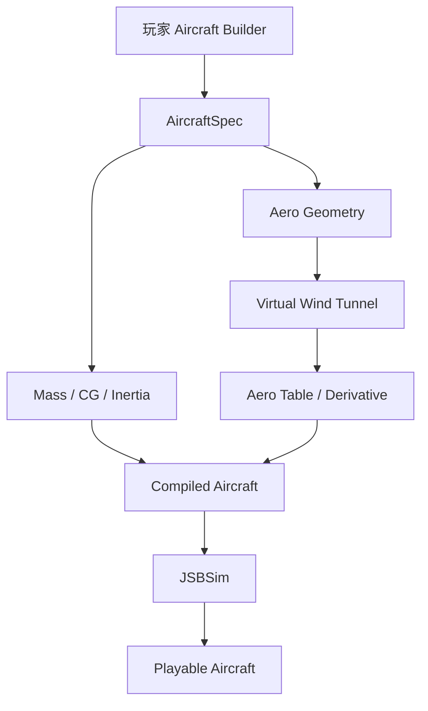

# 07 — 玩家造飞机与 Aircraft Compiler

## 1. 目标

允许玩家自己设计飞机，但不用学空气动力学参数。

玩家负责：

- 外形；
- 翼型；
- 发动机；
- 控制面；
- 武器；
- 结构布局。

Compiler 负责：

> 把几何与结构转换成 JSBSim 能使用的飞行动力学数据。

---

## 2. 不让玩家输入专业气动系数

不要让玩家输入：

```text
CL_alpha
Cm_alpha
Cn_beta
Control Derivative
```

玩家只需要操作：

- Wing；
- Span；
- Sweep；
- Chord；
- Tail；
- Canard；
- Engine；
- Fuel；
- Weapon；
- Mass；
- Control Surface。

---

## 3. Semantic Builder

不要允许完全无语义的 Triangle Soup。

推荐零件：

```text
Fuselage Module
Wing Module
Tail Module
Canard Module
Control Surface
Engine Module
Weapon Bay
Fuel Tank
Sensor Module
```

玩家仍然可以自由调整：

- Position；
- Rotation；
- Scale；
- Sweep；
- Thickness；
- Airfoil；
- Chord；
- Span；
- Control Surface Size。

---

## 4. 坐标标准

编辑器规定：

```text
+X = Forward
+Y = Right
+Z = Up
```

因此系统永远知道：

> 哪边是机头。

不需要再从 Mesh 自动猜。

---

## 5. 编译流程



---

## 6. Virtual Wind Tunnel

扫描：

- Mach；
- AoA；
- Beta；
- Control Surface Deflection。

得到：

\[
C_L,\;C_D,\;C_Y,\;C_l,\;C_m,\;C_n
\]

然后转换成 JSBSim 表。

---

## 7. 首版 Sweep

可以先：

```text
Mach:
0.2
0.6
0.9
1.2
1.6

AoA:
-10
-5
0
5
10
15
20
25

Beta:
-10
0
10
```

控制面：

```text
Elevator / Elevon:
-20
0
20

Aileron:
-20
0
20

Rudder:
-20
0
20
```

不要所有维度全组合。

采用：

- Baseline Table；
- Stability Derivative；
- Control Derivative。

---

## 8. 第三方候选

### OpenVSP + VSPAERO

适合：

- 参数化飞机几何；
- Wing / Body；
- Stability；
- AoA / Beta / Mach Sweep；
- Control Surface。

优先定位：

> **详细离线 Aircraft Compiler。**

### AeroSandbox

适合：

- Python 快速原型；
- Low-order Aero；
- VLM；
- Lifting Line；
- Airfoil；
- Empirical Model；
- Optimisation。

优先定位：

> **快速实验与 Fast Compiler。**

### AVL

适合参考：

- Vortex Lattice；
- Stability；
- Control Surface。

商业使用前必须单独检查 License。

---

## 9. Fast Compile / Detailed Compile

### Fast Compile

目标：

> 玩家点击后快速得到可飞版本。

可能使用：

```text
Geometry Heuristic
+
Airfoil Database
+
Lifting Surface Approximation
+
Empirical Body Drag
```

### Detailed Compile

目标：

> 编辑阶段生成更高质量模型。

使用：

```text
OpenVSP / VSPAERO
```

或者类似低阶求解器。

---

## 10. 重心

由零件质量计算：

\[
CG=\frac{\sum m_i r_i}{\sum m_i}
\]

例如：

- Engine；
- Radar；
- Fuel；
- Missile；
- Wing；
- Fuselage。

玩家把大 Radar 放到 Nose：

> CG 会真实前移。

打掉弹药、消耗燃油：

> CG 也可能变化。

---

## 11. 惯量

Compiler 还必须估计：

- Roll Inertia；
- Pitch Inertia；
- Yaw Inertia。

相同总质量、不同质量分布：

> 飞行手感应该不同。

---

## 12. 自动检查控制能力

Compiler 可以输出：

```text
AERODYNAMIC ANALYSIS

✓ 能产生足够升力
✓ Pitch Authority 足够
✓ Roll Authority 足够

⚠ Yaw Stability 较差
⚠ CG 过于靠后
⚠ 低速 Elevator Authority 不足
```

玩家不需要知道：

```text
Cn_beta
Cm_alpha
```

这些专业术语。

---

## 13. 飞机设计本身变成玩法

例如：

```text
玩家造飞机
   ↓
Compile
   ↓
Yaw Stability: POOR
   ↓
增大 Vertical Tail
   ↓
Compile
   ↓
Yaw Stability: GOOD
```

这样玩家会逐渐通过“试”和“结果”理解飞机设计。

---

## 14. 支持各种布局

Compiler 应支持：

- Conventional Tail；
- All-moving Stabilator；
- Delta + Elevon；
- Canard；
- Twin Tail；
- Flying Wing；
- Thrust Vectoring。

JSBSim 最终只需要正确 Force / Moment。

---

## 15. 高攻角扩展

Low-order Solver 在普通飞行区最可靠。

Post-stall 可以采用：

```text
Normal Solver Result
+
High-AoA Empirical Extension
+
Aircraft-specific Tuning
```

目标：

> 游戏级可信，而不是科研 CFD。

---

## 16. Aircraft Compiler 是项目的重要核心技术

真正有价值的不是自己重写一个气动 Solver。

而是：

> **玩家语义化飞机 → 求解器几何 → 气动结果 → JSBSim 飞机**

这个 Translation Layer 很可能会成为项目最独特的技术之一。
