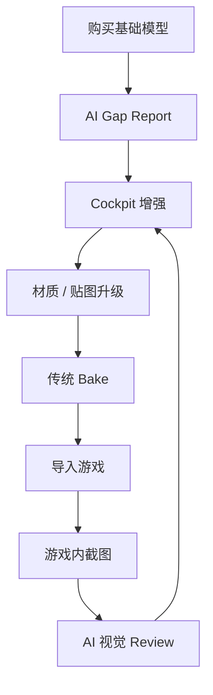

# 08 — AI 辅助资产制作流程

## 1. 基本策略

不建议：

> 完全依赖 AI 从零生成最终战斗机资产。

更现实：

> **购买一个基础结构和轮廓靠谱的 Blender 模型，再让 AI / Agent 持续增强。**

---

## 2. 买模型优先检查

优先：

- Silhouette；
- 商用许可；
- 活动部件分离；
- Cockpit 基础结构；
- Landing Gear 分离；
- Canopy 分离；
- Control Surface 分离；
- UV 可用；
- Normal / Topology 不至于完全不可维护。

不必一开始追求：

- 完美 Cockpit；
- 超高清贴图；
- 完整 Gear Bay；
- 所有微小结构。

---

## 3. AI 最适合做的事情

- Cockpit Dressing；
- Material 提升；
- Decal；
- Roughness；
- Panel Detail；
- PBR Texture Enhancement；
- Object Naming；
- Scene Organisation；
- Rig；
- Pivot 修正；
- Blender 重复操作；
- Export 自动化。

---

## 4. 第一人称 Cockpit

不要求 DCS 级一比一。

目标：

> **第一人称看起来可信、沉浸。**

### A 级必须做好

- Seat；
- Main Panel；
- HUD；
- MFD；
- Stick；
- Throttle；
- Canopy Frame。

### B 级建议

- Side Console；
- Switch Group；
- Seat Belt；
- Cockpit Boxes；
- Pedal 大结构。

### C 级可以模糊处理

- 隐蔽小结构；
- 精确维护标签；
- 小螺丝；
- 看不到的内部。

---

## 5. 贴图流程

AI 适合：

- 参考图分析；
- Panel Line；
- Decal；
- Warning Label；
- Dirt / Wear；
- Screen Graphic；
- Normal / Height Source；
- Screenshot Critique。

传统工具负责：

- UV；
- Normal Bake；
- AO；
- Curvature；
- 最终 PBR Export。

原则：

> **AI 是 Pipeline Assistant，不是 Bake Engine。**

---

## 6. 迭代式流程



核心：

> 多轮迭代，而不是一次生成完美成品。

---

## 7. 机械动画 Rig

飞机是刚性机械结构。

如果部件已经分开：

```text
GearDoor
GearStrut
Wheel
Rudder
Aileron
Elevator
Canopy
```

AI 很适合：

- 建立层级；
- 设置 Pivot；
- 判断 Axis；
- 生成 Constraint；
- 生成 Curve；
- 生成 Engine Asset。

---

## 8. 优先 Mechanical Rig，而不是 Skeletal Mesh

自研引擎可以直接：

```cpp
struct ArticulatedNode
{
    MeshHandle mesh;
    int parent;
    Transform bindTransform;
    Transform currentTransform;
};
```

驱动：

- Gear；
- Door；
- Canopy；
- Flap；
- Aileron；
- Rudder；
- Stabilator。

---

## 9. Gear Animation

推荐：

```text
gearPosition 0..1
      ↓
Mechanical Rig
      ↓
Door / Strut / Linkage
```

用 Curve，不用简单线性。

---

## 10. 连杆可以“视觉上正确”

首版：

```text
partAngle = Curve(gearPosition)
```

已经足够。

不要为了起落架去开发完整 CAD Constraint Solver。

玩家判断的是：

> 看起来是否合理。

---

## 11. Wheel / Suspension

轮速：

\[
\omega=\frac{v}{r}
\]

Suspension 可以从 JSBSim Ground Reaction 读取 Compression。

这样视觉和物理自然一致。

---

## 12. Agent 类型

最适合的是：

> **能稳定调用 Blender / MCP / Script 的工程型 Agent。**

理想循环：

```text
Inspect
→ Modify
→ Screenshot / Render
→ Review
→ Modify
```

最好定义：

```text
AircraftAssetSpec
```

包含：

- Part Name；
- Pivot；
- Required Material；
- Movable Part；
- LOD；
- Export Rule。

---

## 13. 真实飞机 IP

使用真实军机需要注意：

- Trademark；
- Aircraft Configuration；
- Livery；
- Logo；
- 3D Model License；
- Texture Copyright。

开发早期更安全的路线：

- 使用有明确许可的 Base Asset；
- 做原创 / 虚构化飞机；
- 借鉴真实布局和气动特点；
- 不直接复制其他游戏资产。
