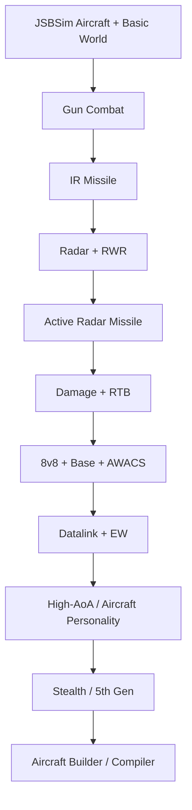

# 09 — 已确定决策与待定问题

## 1. 已经基本确定的方向

### 游戏定位

- 半拟真 / Sim-lite；
- Physics-driven；
- Multiplayer-first；
- 现代空战；
- 信息战 + 飞行操作双核心；
- 系统制造玩家故事。

### 飞行动力学

- JSBSim 作为核心 Aircraft FDM；
- 高 AoA 与 Post-stall 要有意义；
- 超机动来自物理，不是技能键；
- Fly-by-wire 帮新手；
- Manual Skill 给高手额外空间。

### 网络

- Dedicated Authoritative Server；
- Server 决定 Sensor Truth；
- Server 决定 Weapon / Hit / Damage；
- Client 负责呈现和合理 Prediction。

### 机炮

- 数学 Projectile Pool；
- Swept Collision；
- 有飞行时间；
- Tracer 与真实炮弹一致；
- HUD Lead 与真实弹道共用模型。

### 导弹

- 能量重要；
- 发射不等于必杀；
- Countermeasure 制造 Tracking Uncertainty；
- Active Radar Missile 有 Midcourse / Active 阶段。

### 传感器

- Detection 是 Track Quality；
- Radar Mode 有取舍；
- RWR 需要非常好读；
- Datalink / AWACS 是核心；
- EW 影响 Information Quality。

### 对局

- 首版约 8v8；
- 地图约 160 × 160 km；
- 主基地约 120–140 km；
- 敌方基地可攻击；
- 不使用魔法 Safe Zone 解决 Rush；
- 胜负不是纯 Kill Count。

### 飞机角色

- 没有强制 RPG Class；
- 角色来自飞机 / 挂载 / 油量 / 传感器；
- 外挂真实改变飞行；
- 高级机可以通过战略价值 / 库存平衡。

### Stealth

- 不是 Invisible；
- 影响 Detection / Track；
- 提供 Initiative；
- Sensor Fusion 是核心五代机特征。

### 玩家造飞机

- Semantic Module；
- Aircraft Compiler 自动生成 Aero Model；
- OpenVSP/VSPAERO + AeroSandbox 为主要候选；
- 最终编译成 JSBSim Aircraft。

### 资产

- 买 Base Model；
- AI / Agent 做增强；
- 优先 Cockpit；
- 使用刚性 Mechanical Rig。

---

## 2. 设计红线

### 不要滑向 Full Study Sim

避免：

- 繁琐启动流程；
- 大量开关记忆；
- 强制学习真实程序。

### 不要滑向 Pure Arcade

避免：

- 无物理意义的转弯；
- Teleport Missile；
- Magic Countermeasure；
- HP-only Aircraft；
- 挂载无重量与阻力。

### 不要 RPG 化

避免：

```text
Agility +20
Radar +15
Stealth +30
```

如果能通过真实系统表达，就不用抽象 Buff。

### 不要 Guaranteed Kill Missile

超远程弹也必须有：

- Track Uncertainty；
- Target Defence；
- Midcourse；
- Energy；
- Counterplay。

### 不要 Special Move Flying

避免：

```text
Press Q → Cobra
```

让动作来自真实飞行状态。

---

## 3. 还没有最终确定的问题

### Match Economy

- 每边能损失多少飞机？
- Aircraft Inventory 是否每局重置？
- Stealth Fighter 的战略成本如何定？

### Respawn

- Respawn Delay；
- Pilot Survival 是否影响；
- Forward Base 如何使用。

### Mission Variety

以后可能：

- Air Superiority；
- AWACS Escort / Hunt；
- Radar Suppression；
- Strike；
- Transport Escort；
- Carrier Operations。

### Sensor Fidelity

需要不断测试：

> 真实不确定性 VS 玩家可读性。

### EW Fidelity

要做到：

> 有深度，但不能变成看不见的 Excel Combat。

### Missile Fidelity

需要继续确定：

- Seeker；
- Midcourse；
- Proximity Fuse；
- Countermeasure；
- Aero Model。

### Damage Fidelity

需要定义系统粒度：

- Engine；
- Control Surface；
- Fuel；
- Radar；
- Flight Control Computer；
- Hydraulic；
- Electrical；
- Structure。

### Aircraft Builder 自由度

需要确定：

- 允许多奇怪的飞机；
- Procedural Geometry 到什么程度；
- Semantic Module 限制多少。

### High-AoA Compiler

需要建立：

> Low-order Aero → Game Post-stall Model

的可靠方法。

---

## 4. 推荐首个 Vertical Slice

第一版可玩：

```text
2 种飞机 Archetype
1 张地图
4v4 或 8v8
Gun
IR Missile
Active Radar Missile
Radar
RWR
Flare / Chaff
Basic Datalink
Fuel
Component Damage
Return-to-Base
```

第一版不要同时做：

- Stealth；
- Full EW；
- Aircraft Builder；
- 大量真实机型；
- 巨型战略 Campaign。

先证明：

> 核心空战循环真的好玩。

---

## 5. 推荐开发顺序



原则：

> **先尽快回到真正可玩的飞行与空战，不要过早被大型旁支系统拖走。**

---

## 6. 一句话产品定义

> **一个把可信飞行物理、信息战、飞机配置与玩家操作技巧结合起来，并压缩成短时高密度多人空战战役的现代空战沙盒。**
