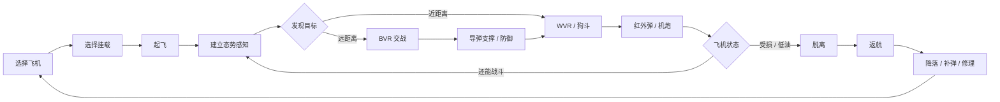

# 多人现代空战游戏 — 设计与技术记录

> 当前项目讨论的长期维护文档。  
> 状态：**持续更新中的设计基线**  
> 核心方向：**基于可信物理、强调信息战与操作上限的半拟真多人现代空战沙盒。**

---

## 1. 项目定位

这个项目**不是**：

- 需要玩家读几百页手册才能正常游玩的硬核学习型模拟器；
- 飞机只是不同皮肤、底层运动高度简化的纯街机空战游戏；
- 只围绕“看到敌人—发射导弹—击杀—复活”的空中 Deathmatch。

当前希望形成的产品定位是：

> **一个半拟真 / Sim-lite 的多人现代空战游戏：底层物理可信，操作门槛可控，雷达、数据链与信息战有深度，同时高手的手动飞行能力具有真实战术价值。**

内部可以使用一句简洁定义：

> **Physics-driven Multiplayer Air Combat Sandbox**  
> 基于物理规则驱动的多人现代空战沙盒。

另一个重要设计原则：

> **底层规则可以复杂，但玩家看到和操作到的东西必须尽量直观。**

---

## 2. 核心设计支柱

### 2.1 可信物理，但不要求专业训练

- 不同飞机必须有不同飞行性格；
- 速度、高度、能量、攻角、载荷、阻力、燃油都要有实际意义；
- 玩家不需要学习专业空气动力学；
- 现代电传飞控可以自动处理日常协调；
- 但高手必须可以通过更好的手动操作获得优势。

### 2.2 信息本身就是武器

空战不只是“谁瞄得准”。

玩家应该持续面对不完整信息：

- 雷达接触；
- Track Quality；
- RWR 告警；
- Datalink 数据；
- AWACS 信息；
- 目视确认；
- 红外 / 被动传感器；
- 电子战干扰；
- 地形遮蔽。

### 2.3 武器是系统，不是技能按钮

武器必须拥有可理解的物理和战术逻辑：

- 机炮炮弹有真实飞行时间和弹道；
- 曳光弹轨迹与真实弹道一致；
- 导弹有能量、导引阶段和 seeker 状态；
- 发射导弹不等于必杀；
- 反制措施制造“不确定性”，而不是无敌按钮。

### 2.4 现代技术不能抹掉操作高手的价值

游戏必须支持：

- BVR 信息与战术决策；
- 近距红外导弹战；
- 机炮狗斗；
- 能量管理；
- 高攻角机动；
- Overshoot 操作；
- 失速 / Departure 恢复；
- 带伤返航。

高端传感器可以提供先手，但不能代替飞行技术。

### 2.5 一次出击应该形成完整故事

理想的一次 sortie：

```text
机场
  ↓
起飞
  ↓
编队 / 搜索
  ↓
接触目标
  ↓
BVR
  ↓
Merge / WVR
  ↓
损伤 / 燃油 / 弹药决策
  ↓
脱离
  ↓
返航
  ↓
降落 / 补给 / 修理
```

把受损飞机飞回基地，本身应该是一件值得记住的事情。

---

## 3. 当前已经形成的基础技术决定

| 模块 | 当前基线 |
|---|---|
| 游戏引擎 | 自研 C++ |
| 渲染器 | Vulkan |
| 飞机飞行动力学 | JSBSim |
| 通用物理 | 已有自研物理引擎 |
| 飞机刚体状态权威 | JSBSim |
| 通用物理中的飞机 | Kinematic / Query Proxy |
| 联机 | Dedicated Authoritative Server |
| 首个多人原型 | 约 8v8 |
| 首张地图 | 约 160 km × 160 km |
| 对局目标时长 | 约 30–40 分钟 |
| 游戏基调 | 半拟真 / Sim-lite |
| 机炮 | 批量数学炮弹 + Swept Collision |
| 导弹 | 独立 Guidance / Missile Dynamics |
| 地形 | 分块 Heightfield + GPU Driven |
| 玩家造飞机 | Aircraft Builder → Aircraft Compiler → JSBSim |
| 气动编译候选 | OpenVSP/VSPAERO、AeroSandbox |
| AI 使用方式 | 资产制作、Blender 自动化、Authoring 辅助，不参与实时飞行动力学决策 |

---

## 4. 文档目录

### 玩法设计

- [01_核心玩法与产品基调.md](01_核心玩法与产品基调.md)  
  整体玩法哲学、技能结构、玩家体验目标。

- [02_武器_雷达_传感器与空战.md](02_武器_雷达_传感器与空战.md)  
  机炮、导弹、雷达、RWR、数据链、EW、隐身与反制。

- [03_对局_地图_机场与胜负目标.md](03_对局_地图_机场与胜负目标.md)  
  8v8、地图尺度、机场、AWACS、雷达站与胜负机制。

- [04_飞机角色_挂载与资源.md](04_飞机角色_挂载与资源.md)  
  飞机角色、挂载取舍、油量、四代机、五代机与支援角色。

- [05_飞行操作_狗斗与超机动.md](05_飞行操作_狗斗与超机动.md)  
  能量空战、Rudder、高攻角、失速后机动与高手操作上限。

### 技术设计

- [06_技术架构.md](06_技术架构.md)  
  JSBSim、自研引擎、物理、联网、武器、地形与世界系统。

- [07_玩家造飞机与AircraftCompiler.md](07_玩家造飞机与AircraftCompiler.md)  
  玩家自定义飞机、虚拟风洞和气动模型编译流程。

- [08_AI辅助资产制作流程.md](08_AI辅助资产制作流程.md)  
  Blender、购买模型、AI 修补、座舱、贴图与机械动画。

- [09_已确定决策与待定问题.md](09_已确定决策与待定问题.md)  
  已经基本确定的方向、设计红线和后续待验证问题。

---

## 5. 高层游戏循环



---

## 6. 新功能设计检查标准

每加入一个系统，都问：

1. 它是否制造了真正的玩家决策？
2. 它是否奖励理解和技巧，而不是强迫玩家学专业流程？
3. 它是否能和已有系统互相作用？
4. 它是否能制造玩家之间值得记住的故事？
5. 能不能用真实或系统化规则表达，而不是 RPG Buff？
6. 是否保留了信息不确定性？
7. 是否存在明确的反制或 Counterplay？

如果大多数答案是否定的，这个功能大概率不应该进入核心玩法。
