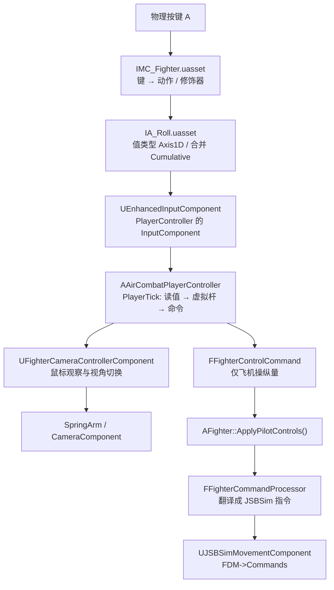

# 飞行输入系统设计说明（UE 5.8 Enhanced Input 架构）

实际飞行状态与模型响应使用独立的 [飞行监测 UMG](../FlightDebug/README.md)；本页输入面板继续显示 RAW → STICK → RESP → CMD，二者可以同时开启。

> 本文描述**当前工程里实际生效**的飞行输入架构：资产怎么组织、C++ 每一层负责什么、
> 一帧内数据怎么流动、以后怎么改键位 / 加功能 / 接重绑定 UI。
>
> 文中所有键位、映射名、值类型都是从磁盘上的资产实测 dump 出来的
> （`Content/Blueprints/Input/IMC_Fighter.uasset`、`IA_*.uasset`），
> 不是设计意图的臆测。
>
> 引擎版本：**UE 5.8.3**　|　最后核对日期：2026-10-26

---

## 目录

1. [总览：一次按键的完整旅程](#1-总览一次按键的完整旅程)
2. [分层与职责边界](#2-分层与职责边界)
3. [资产层](#3-资产层)
   - 3.1 [IMC_Fighter —— 唯一的键位事实来源](#31-imc_fighter--唯一的键位事实来源)
   - 3.2 [IA 资产 —— 值类型与合并方式](#32-ia-资产--值类型与合并方式)
   - 3.3 [Player Mappable Key Settings（PMKS）—— 21 条可重绑映射](#33-player-mappable-key-settingspmks--21-条可重绑映射)
   - 3.4 [DA_FighterInputConfig —— C++ 引用资产的唯一入口](#34-da_fighterinputconfig--c-引用资产的唯一入口)
4. [C++ 层](#4-c-层)
   - 4.1 [AAirCombatPlayerController](#41-aaircombatplayercontroller)
   - 4.2 [UFighterInputConfig](#42-ufighterinputconfig)
   - 4.3 [FKeyboardVirtualStick —— 键盘虚拟杆](#43-fkeyboardvirtualstick--键盘虚拟杆)
   - 4.4 [FFighterAxisResponse —— 手感曲线](#44-ffighteraxisresponse--手感曲线)
   - 4.5 [FFighterControlCommand —— 输入层与飞控层的边界](#45-ffightercontrolcommand--输入层与飞控层的边界)
   - 4.6 [AFighter 的输入侧接口](#46-afighter-的输入侧接口)
   - 4.7 [飞行输入调试面板（UMG）](#47-飞行输入调试面板umg)
5. [输入、动力学和相机帧序](#5-输入动力学和相机帧序)
6. [关键机制与"为什么这么写"](#6-关键机制与为什么这么写)
7. [生命周期与状态重置](#7-生命周期与状态重置)
8. [扩展指南](#8-扩展指南)
9. [验证](#9-验证)
10. [已删除的旧体系](#10-已删除的旧体系)
11. [红线：不能做的事](#11-红线不能做的事)
12. [文件清单](#12-文件清单)

---

## 1. 总览：一次按键的完整旅程



对应的真实调用链：

```
EKeys::A 按下
  → IMC_Fighter 里的这条映射命中（Action=IA_Roll, Modifiers=[InputModifierNegate], Key=A）
  → IA_Roll 的值类型是 Axis1D、合并方式是 Cumulative
  → UEnhancedInputComponent 算出本帧 IA_Roll 的值 = -1
  → AAirCombatPlayerController::PlayerTick 读到这个 -1
  → FKeyboardVirtualStick 以 3.0/秒 的速率把杆位推向 -1
  → FFighterAxisResponse 施加死区 / 指数曲线
  → 打包成 FFighterControlCommand
  → AFighter::ApplyPilotControls(Command)
  → JSBSim 的 OnBeforeSimulation 回调里 FFighterCommandProcessor::Update 把杆量写进 FDM->Commands.Aileron
  → JSBSim 算出力矩，飞机滚转
```

**一句话原则：物理键位只存在于 IMC 资产里；C++ 里一个键名都没有。**

---

## 2. 分层与职责边界

| 层 | 资产 / 类 | 负责 | **不**负责 |
|---|---|---|---|
| 键位表 | `IMC_Fighter` | 哪个物理键 → 哪个动作；修饰器；触发器 | 值的含义 |
| 动作 | `IA_*`（16 个） | 值类型（Axis1D / Boolean）、合并方式（Cumulative / TakeHighestAbsoluteValue） | 键位 |
| 重绑元数据 | `PMKS`（21 个） | 可重绑映射的稳定名字、显示名、分类 | 键位本身 |
| 配置引用 | `DA_FighterInputConfig` | 哪个 IA 对应哪个功能 | **任何**键位 / 值类型 / 修饰器 / 触发器 |
| 输入运行时 | `AAirCombatPlayerController` | 注册 IMC、绑定动作、每帧读值、组装命令、转发 | 飞控律、飞机状态 |
| 手感 | `FKeyboardVirtualStick` / `FFighterAxisResponse` | 数字量 → 模拟量、速率限制、死区、指数曲线 | 键名、IMC、飞机 |
| 边界结构 | `FFighterControlCommand` | 传递飞机操纵意图 | 鼠标观察、资产引用、JSBSim 类型 |
| 本地观察 | `UFighterCameraControllerComponent` | 环视、限制、模式、回正；SpringArm 负责追尾位置、延迟和避障 | 飞控、飞行命令、JSBSim |
| 指令处理 | `AFighter` / `FFighterCommandProcessor` | 意图 → JSBSim 指令；油门 / 配平 / 构型的有状态量 | 键位、输入设备 |

**连续操纵通过 `FFighterControlCommand` 传递；起落架和配平复位仍走离散接口。观察输入直接交给相机组件。**
这个边界是将来"客户端 → 服务器传控制指令"时唯一需要打通的地方：
把 `FFighterControlCommand` 变成可序列化的网络消息即可，**不需要动任何 IMC / IA / 绑定**。

---

## 3. 资产层

所有输入资产都在 `/Game/Blueprints/Input/`：

```
Content/Blueprints/Input/
├── IMC_Fighter.uasset        ← 唯一的键位事实来源（23 条映射）
├── IA_CameraYaw.uasset       IA_CameraPitch.uasset
├── IA_Pitch.uasset           IA_Roll.uasset          IA_Yaw.uasset
├── IA_TrimPitch.uasset       IA_TrimYaw.uasset      IA_TrimRoll.uasset
├── IA_Flap.uasset
├── IA_ThrottleUp.uasset      IA_ThrottleDown.uasset
├── IA_SpeedBrake.uasset      IA_Brake.uasset
├── IA_Gear.uasset            IA_Camera.uasset        IA_ResetTrim.uasset
└── DA_FighterInputConfig.uasset  ← 17 个显式引用的集合
```

### 3.1 IMC_Fighter —— 唯一的键位事实来源

`/Game/Blueprints/Input/IMC_Fighter.uasset`，共 **23 条映射**。

| # | 物理键 | 动作 | 值类型 | 合并方式 | 修饰器 | 玩家可重绑名 | 显示名 |
|---|---|---|---|---|---|---|---|
| 00 | `MouseX` | `IA_CameraYaw` | Axis1D | TakeHighestAbsoluteValue | — | *（不可重绑）* | — |
| 01 | `MouseY` | `IA_CameraPitch` | Axis1D | TakeHighestAbsoluteValue | — | *（不可重绑）* | — |
| 02 | `D` | `IA_Roll` | Axis1D | **Cumulative** | — | `Flight.RollPositive` | Roll Right |
| 03 | `A` | `IA_Roll` | Axis1D | **Cumulative** | `InputModifierNegate` | `Flight.RollNegative` | Roll Left |
| 04 | `W` | `IA_Pitch` | Axis1D | **Cumulative** | — | `Flight.PitchPositive` | Pitch Up |
| 05 | `S` | `IA_Pitch` | Axis1D | **Cumulative** | `InputModifierNegate` | `Flight.PitchNegative` | Pitch Down |
| 06 | `E` | `IA_Yaw` | Axis1D | **Cumulative** | — | `Flight.YawPositive` | Yaw Right |
| 07 | `Q` | `IA_Yaw` | Axis1D | **Cumulative** | `InputModifierNegate` | `Flight.YawNegative` | Yaw Left |
| 08 | `T` | `IA_TrimPitch` | Axis1D | **Cumulative** | — | `Flight.TrimPitchPositive` | Trim Nose Up |
| 09 | `Y` | `IA_TrimPitch` | Axis1D | **Cumulative** | `InputModifierNegate` | `Flight.TrimPitchNegative` | Trim Nose Down |
| 10 | `U` | `IA_TrimYaw` | Axis1D | **Cumulative** | — | `Flight.TrimYawPositive` | Trim Yaw Right |
| 11 | `O` | `IA_TrimYaw` | Axis1D | **Cumulative** | `InputModifierNegate` | `Flight.TrimYawNegative` | Trim Yaw Left |
| 12 | `J` | `IA_TrimRoll` | Axis1D | **Cumulative** | — | `Flight.TrimRollPositive` | Trim Roll Right |
| 13 | `L` | `IA_TrimRoll` | Axis1D | **Cumulative** | `InputModifierNegate` | `Flight.TrimRollNegative` | Trim Roll Left |
| 14 | `Z` | `IA_Flap` | Axis1D | **Cumulative** | — | `Flight.FlapExtend` | Flaps Extend |
| 15 | `X` | `IA_Flap` | Axis1D | **Cumulative** | `InputModifierNegate` | `Flight.FlapRetract` | Flaps Retract |
| 16 | `LeftShift` | `IA_ThrottleUp` | Boolean | TakeHighestAbsoluteValue | — | `Flight.ThrottleIncrease`¹ | Throttle Increase |
| 17 | `LeftControl` | `IA_ThrottleDown` | Boolean | TakeHighestAbsoluteValue | — | `Flight.ThrottleDecrease`¹ | Throttle Decrease |
| 18 | `C` | `IA_SpeedBrake` | Boolean | TakeHighestAbsoluteValue | — | `Flight.SpeedBrake`¹ | Speed Brake |
| 19 | `C` | `IA_Brake` | Boolean | TakeHighestAbsoluteValue | — | `Flight.WheelBrake`¹ | Wheel Brake |
| 20 | `G` | `IA_Gear` | Boolean | TakeHighestAbsoluteValue | — | `Aircraft.ToggleLandingGear`¹ | Landing Gear |
| 21 | `V` | `IA_Camera` | Boolean | TakeHighestAbsoluteValue | — | `Aircraft.ToggleCamera`¹ | Toggle Camera |
| 22 | `P` | `IA_ResetTrim` | Boolean | TakeHighestAbsoluteValue | — | `Aircraft.ResetTrim`¹ | Reset Trim |

¹ 这些名字**不是**写在 IMC 映射上的，而是写在对应 **IA 资产自带的 PMKS** 上，
IMC 侧用 `InheritSettingsFromAction` 继承。详见 [3.3](#33-player-mappable-key-settingspmks--21-条可重绑映射)。

> **关于修饰器的说明**：`Modifiers` / `Triggers` / `SettingBehavior` 在
> `FEnhancedActionKeyMapping` 里是 **protected** 成员，Unreal Python 读不到
> （`get_editor_property` 报 "not a valid Object"）。
> 上表的修饰器列依据的是 **C++ 自动化测试 `AirCombat.Input.Config.ImcOppositeKeyMapping`**：
> 它逐条遍历 `IMC->GetMappings()`，断言每个"双键轴动作"**正好 2 条映射、其中正好 1 条挂了 `UInputModifierNegate`**。
> 该测试当前是 **通过** 状态。
>
> 设计意图上 Negate 挂在**负方向**那条（`A` / `S` / `Q` / `Y` / `M` / `L` / `X`），
> 因为数字键按下得到的原始值恒为 +1，必须翻成 −1 才能和正方向抵消。

**触发器**：当前 23 条映射**一条触发器都没挂**。
这意味着：

* 轴动作是 **Continuous** 语义 —— 按住就一直有值；
* 布尔动作如果被 **Triggered** 绑定，每帧都会触发 —— 所以一次性开关
  （起落架 / 切视角 / 复位配平）在 **C++ 侧用 `ETriggerEvent::Started`** 绑定，
  按下瞬间触发一次，按住不会重复。

### 3.2 IA 资产 —— 值类型与合并方式

| IA 资产 | 值类型 | 合并方式 | 自带 PMKS 名 |
|---|---|---|---|
| `IA_CameraYaw` | Axis1D | TakeHighestAbsoluteValue | — |
| `IA_CameraPitch` | Axis1D | TakeHighestAbsoluteValue | — |
| `IA_Roll` | Axis1D | **Cumulative** | — |
| `IA_Pitch` | Axis1D | **Cumulative** | — |
| `IA_Yaw` | Axis1D | **Cumulative** | — |
| `IA_TrimPitch` | Axis1D | **Cumulative** | — |
| `IA_TrimYaw` | Axis1D | **Cumulative** | — |
| `IA_TrimRoll` | Axis1D | **Cumulative** | — |
| `IA_Flap` | Axis1D | **Cumulative** | — |
| `IA_ThrottleUp` | Boolean | TakeHighestAbsoluteValue | `Flight.ThrottleIncrease` |
| `IA_ThrottleDown` | Boolean | TakeHighestAbsoluteValue | `Flight.ThrottleDecrease` |
| `IA_SpeedBrake` | Boolean | TakeHighestAbsoluteValue | `Flight.SpeedBrake` |
| `IA_Brake` | Boolean | TakeHighestAbsoluteValue | `Flight.WheelBrake` |
| `IA_Gear` | Boolean | TakeHighestAbsoluteValue | `Aircraft.ToggleLandingGear` |
| `IA_Camera` | Boolean | TakeHighestAbsoluteValue | `Aircraft.ToggleCamera` |
| `IA_ResetTrim` | Boolean | TakeHighestAbsoluteValue | `Aircraft.ResetTrim` |

> `IA_Flap` 是 **Cumulative** 而不是布尔，因为它要区分"放下"（Z）和"收起"（X）两个方向，
> 和配平同理。

### 3.3 Player Mappable Key Settings（PMKS）—— 21 条可重绑映射

UE 5.8 的名字解析链：

```
FEnhancedActionKeyMapping::GetMappingName()
  → IsPlayerMappable()                      // GetPlayerMappableKeySettings() != nullptr
  → GetPlayerMappableKeySettings()          // 按 SettingBehavior 决定取哪一份
      · InheritSettingsFromAction  → 取 Action 自带的 PMKS
      · OverrideSettings           → 取映射自己的 PMKS
      · IgnoreSettings             → 返回 nullptr（不可重绑）
  → UPlayerMappableKeySettings::MakeMappingName(this) → GetMappingName() → Name
```

本工程用的是**两级 PMKS**：

| 组 | 数量 | PMKS 放在哪 | SettingBehavior | 例子 |
|---|---|---|---|---|
| 双键轴动作 | 14 | **IMC 的每条映射上**（各一个独立 PMKS 子对象） | `OverrideSettings` | `Flight.RollPositive` / `Flight.RollNegative` |
| 单键离散动作 | 7 | **IA 资产上**（每个 IA 一个） | `InheritSettingsFromAction` | `Flight.ThrottleIncrease` / `Aircraft.ToggleLandingGear` |
| 鼠标轴 | 2 | 完全没有 PMKS | → 不可重绑 | — |

**为什么轴动作的 PMKS 放在 IMC 映射上**：`IA_Roll` 一个动作对应 D 和 A **两个独立的物理键**。
如果 PMKS 放在 IA 上，两个键会共用同一个名字，重绑定 UI 就无法区分"改滚转左"和"改滚转右"。
放在 IMC 映射上，每个物理映射一条独立命名 → 名字天然唯一。

**为什么离散动作的 PMKS 放在 IA 上**：它们一个动作只有一个物理键，
名字放在 IA 上更省事，而且以后给同一个动作加第二个键时，
新映射默认 `InheritSettingsFromAction` 会自动继承同一个名字（届时可改成 Override）。

**21 条映射名的完整清单**（自动化测试逐条核对过）：

```
Flight.RollPositive      Flight.RollNegative
Flight.PitchPositive     Flight.PitchNegative
Flight.YawPositive       Flight.YawNegative
Flight.TrimPitchPositive Flight.TrimPitchNegative
Flight.TrimYawPositive   Flight.TrimYawNegative
Flight.TrimRollPositive  Flight.TrimRollNegative
Flight.FlapExtend        Flight.FlapRetract
Flight.ThrottleIncrease  Flight.ThrottleDecrease
Flight.SpeedBrake        Flight.WheelBrake
Aircraft.ToggleLandingGear
Aircraft.ToggleCamera
Aircraft.ResetTrim
```

### 3.4 DA_FighterInputConfig —— C++ 引用资产的唯一入口

`/Game/Blueprints/Input/DA_FighterInputConfig.uasset`，类型 `UFighterInputConfig`（`UDataAsset` 子类）。

它**只是一组显式引用**，17 个：

| 属性 | 指向 |
|---|---|
| `FlightKeyboardContext` | `IMC_Fighter` |
| `CameraYawAction` | `IA_CameraYaw` |
| `CameraPitchAction` | `IA_CameraPitch` |
| `PitchAction` / `RollAction` / `YawAction` | `IA_Pitch` / `IA_Roll` / `IA_Yaw` |
| `TrimPitchAction` / `TrimYawAction` / `TrimRollAction` | `IA_TrimPitch` / `IA_TrimYaw` / `IA_TrimRoll` |
| `FlapAction` | `IA_Flap` |
| `ThrottleUpAction` / `ThrottleDownAction` | `IA_ThrottleUp` / `IA_ThrottleDown` |
| `SpeedBrakeAction` / `BrakeAction` | `IA_SpeedBrake` / `IA_Brake` |
| `GearAction` / `CameraAction` / `ResetTrimAction` | `IA_Gear` / `IA_Camera` / `IA_ResetTrim` |

**它明确不存**：默认物理键、Negate 值、值类型、触发器、累积（Accumulation）设置。
这些全部属于 IA / IMC 资产，在编辑器里改。

> ⚠ 5.8 的 `TMap::operator[]` 改成了 `FindChecked`（缺 key 直接断言），
> 所以本工程里所有 `TMap` 写入都显式用 `FindOrAdd`。
> 写新代码时请注意这一点。

---

## 4. C++ 层

### 4.1 AAirCombatPlayerController

`Source/AirCombat/Input/AirCombatPlayerController.h|.cpp`
—— 飞行输入的**拥有者**，也是唯一碰 Enhanced Input 的 C++ 类。

#### 公开属性

| 属性 | 说明 |
|---|---|
| `UPROPERTY(EditDefaultsOnly) TObjectPtr<UFighterInputConfig> InputConfig` | 输入配置资产。**由 UPROPERTY 持有 → GC 安全** |
| `UPROPERTY(EditDefaultsOnly) int32 FlightMappingPriority = 0` | 飞行 IMC 在 LocalPlayer 上的优先级 |
| `UPROPERTY(EditAnywhere) FFighterAxisResponse RollKey / PitchKey / YawKey` | 三根键盘轴的手感曲线 |
| `UPROPERTY(EditAnywhere) float KeyAxisMoveRate = 3.f` | 键盘虚拟杆推出速率（杆位/秒），3.0 ≈ 0.33 s 推满 |
| `UPROPERTY(EditAnywhere) float KeyAxisReturnRate = 6.f` | 松键回中速率（杆位/秒） |
| `UPROPERTY(EditAnywhere) bool bInvertPitch = false` | 反转俯仰（实机方向相反时勾，不用改 C++） |
| `UPROPERTY(EditDefaultsOnly) TSubclassOf<UFighterInputDebugWidget> InputDebugWidgetClass` | 调试面板的类。**C++ 构造函数里默认填 `UFighterInputDebugWidget::StaticClass()`** → 不配也能跑 |
| `UPROPERTY(EditAnywhere) bool bShowInputDebug = false` | 调试面板是否显示（也可以用控制台命令切） |

> ⚠ **`KeyAxisMoveRate` / `KeyAxisReturnRate` 曾经是"死属性"**
>
> 这两个 UPROPERTY 从来**没有**传给 `FKeyboardVirtualStick`（全工程 grep `SetRates`
> 只有 `KeyboardVirtualStick.h` 里的定义和构造函数）→ 改它们**完全没有任何效果**，
> 虚拟杆一直用构造时的默认 3.0 / 6.0。
>
> 现在 `PlayerTick` 里补了 `Stick.SetRates(KeyAxisMoveRate, KeyAxisReturnRate);`，
> 属性真的接上了。调试面板的 `MOVE RATE` / `RETURN RATE` 会同时显示
> `prop`（属性值）和 `eff`（虚拟杆实际用的值）—— 两者不一致就说明属性又掉链子了。

#### 生命周期

| 回调 | 做的事 |
|---|---|
| `SetupInputComponent()` | → `InitializeActionBindings()`（幂等，`bBindingsInitialized` 保护） |
| `BeginPlay()` | ① `ValidateInputConfiguration()` ② 再兜一次 `InitializeActionBindings()` ③ `RegisterMappingContextWithUserSettings()` ④ 若已有 Pawn 则 `RegisterFlightMapping()` ⑤ 若 `bShowInputDebug` 则建调试面板 |
| `OnPossess(APawn*)` | ① `ResetInputState()`（旧飞机的输入状态一律不带过去）② `RegisterFlightMapping()` |
| `OnUnPossess()` | ① `UnregisterFlightMapping()` ② `ResetInputState()` |
| `EndPlay()` | 兜底 `UnregisterFlightMapping()`（PIE 结束可能没走 `OnUnPossess`）＋ 销毁调试面板 |
| `PlayerTick(DeltaTime)` | 见下 |

#### 绑定（`InitializeActionBindings()`）

* **12 个连续量**用 **value binding**（`BindActionValue`）：

  ```
  CameraYaw, CameraPitch,
  Pitch, Roll, Yaw,
  TrimPitch, TrimYaw, TrimRoll,
  Flap,
  ThrottleUp, ThrottleDown, SpeedBrake, Brake
  ```

  > ⚠ `BindActionValue` 返回的是**内部数组元素的引用**，之后再 `Add` 别的动作可能让它失效。
  > 所以这里的写法是**只调用、不保存返回值**。
  > 另外 `GetBoundActionValue` 只能读到建过 value binding 的动作 —— 没绑过的永远读回 0。

* **3 个一次性开关**用 **event binding**（`BindAction` + `ETriggerEvent::Started`）：

  | 动作 | 回调 | 落到飞机上的操作 |
  |---|---|---|
  | `GearAction` | `OnGearToggled` | `AFighter::ToggleGear()` → `CommandProcessor.RequestGearToggle()` |
  | `CameraAction` | `OnCameraToggled` | `Fighter->GetCameraController()->ToggleCamera()` |
  | `ResetTrimAction` | `OnResetTrim` | `AFighter::ResetTrim()` → `CommandProcessor.RequestResetTrim()` |

  > 这三个开关由 C++ **独占**，**蓝图里不要再绑一遍**，否则会双触发。
  >
  > `Started` 而不是 `Triggered` —— `Started` 只在"按下瞬间"触发一次；
  > `Triggered` 在按住期间每帧触发，会变成"按住空格每帧收放一次起落架"。

#### 每帧（`PlayerTick`）

```
Super::PlayerTick(DeltaTime)          ← 引擎在这里跑 TickPlayerInput → ProcessInputStack
                                        Enhanced Input 的 value binding 在这里刷新
if (!IsLocalController()) return;      ← 专用服务器上没有本地输入
if (!bRegisteredWithUserSettings) 重新登记 User Settings   ← UserSettings 可能比 BeginPlay 晚建好
Fighter = GetFighter();                ← 不缓存指针，Pawn 随时可能换掉
if (!Fighter || !InputConfig) { ResetInputState(); return; }

① 键盘虚拟杆
   Stick.SetRates(KeyAxisMoveRate, KeyAxisReturnRate)   // 属性 → 虚拟杆（以前漏了）
   Target.Roll  = ReadAxis(IA_Roll)     // −1 / 0 / +1（IMC 里 Cumulative 合并的结果）
   Target.Pitch = ReadAxis(IA_Pitch)
   Target.Yaw   = ReadAxis(IA_Yaw)
   StickPos = Stick.Update(Target, DeltaTime)

② 组装命令
   Command.Roll  = Clamp(RollKey.Apply(StickPos.Roll), -1, 1)
   Command.Pitch = Clamp(PitchKey.Apply(StickPos.Pitch), -1, 1)
   Command.Yaw   = Clamp(YawKey.Apply(StickPos.Yaw), -1, 1)
   if (bInvertPitch) Command.Pitch = -Command.Pitch
   Command.TrimPitch/Yaw/Roll = ReadAxis(...)      // ±1，直接用，不经过虚拟杆
   Command.Flap = ReadAxis(IA_Flap)
   Command.SpeedBrake / Brake = ReadDigital(...)   // 0 / 1
   Command.ThrottleDelta = ReadDigital(ThrottleUp) - ReadDigital(ThrottleDown)   // −1 / 0 / +1
   Fighter->GetCameraController()->AddLookInput(
       ReadAxis(IA_CameraYaw), ReadAxis(IA_CameraPitch)) // 本地观察，像素/帧

③ 转发
   Fighter->ApplyPilotControls(Command)
```

#### IMC / User Settings 的两套 API

| 调用 | 作用 | 在哪调用 |
|---|---|---|
| `Subsystem->AddMappingContext(IMC, Priority)` | **激活**输入，真正吃键 | `RegisterFlightMapping()` |
| `Subsystem->RemoveMappingContext(IMC)` | **停用**输入 | `UnregisterFlightMapping()` |
| `Settings->RegisterInputMappingContext(IMC)` | **登记**映射到用户设置（供未来重绑定 UI 枚举 / 保存） | `RegisterMappingContextWithUserSettings()` |

> ⚠ **这两个不是一回事**，不能互相替代：
> `AddMappingContext` 决定"键按下去有没有反应"；
> `RegisterInputMappingContext` 决定"重绑定 UI 能不能列出这一条、能不能保存"。
> 本工程两个都调了。

`RegisterFlightMapping()` 采用**先摘后加**（`RemoveMappingContext` → `AddMappingContext`），
所以重复 Possess 也不会叠加注册。

`UnregisterFlightMapping()` 除了摘 IMC，还会调 `PlayerInput->FlushPressedKeys()`：
清掉"还按着"的状态，正在进行的动作会收到 `Canceled`，值回到 0。

#### 校验（`ValidateInputConfiguration()`）

`BeginPlay` 时跑一次 `InputConfig->CollectProblems(Problems)`，逐条 `UE_LOG(LogAirCombatInput, Error, ...)`。
每一条都指明**具体是哪个属性 / 哪个动作**，例如：

```
[BP_AirCombatPlayerController_C_0] InputConfig 'DA_FighterInputConfig': RollAction: 动作 'IA_Roll' 的值类型应为 Axis1D，实际是 Boolean
[BP_AirCombatPlayerController_C_0] InputConfig 'DA_FighterInputConfig': BrakeAction: IMC 'FlightKeyboardContext' 里没有 'IA_Brake' 的键位
```

校验内容：
1. `FlightKeyboardContext` 有没有指定；
2. 每个动作引用有没有指定；
3. 每个动作的**值类型**对不对（轴动作必须是 Axis1D，离散动作必须是 Boolean）；
4. 每个动作**在 IMC 里有没有对应的键位**。

不会崩、不会静默替换成别的动作 —— 缺什么就报什么。

### 4.2 UFighterInputConfig

`Source/AirCombat/Input/FighterInputConfig.h|.cpp`

```cpp
UCLASS(BlueprintType)
class AIRCOMBAT_API UFighterInputConfig : public UDataAsset
{
    // 17 个 UPROPERTY(EditDefaultsOnly, BlueprintReadOnly) TObjectPtr<UInputAction> / <UInputMappingContext>
    void CollectProblems(TArray<FString>& OutProblems) const;
};
```

* 引用直接持有资产对象 → **运行时不做任何按名字的查找**，也不需要 `LoadObject` / `StaticLoad`。
* `EditDefaultsOnly` → 只能在类默认值里改（BP 的 Class Defaults），不能在实例上乱改。
* `CollectProblems()` 是纯查询，编辑器 / 运行时都能调，不产生副作用。

### 4.3 FKeyboardVirtualStick —— 键盘虚拟杆

`Source/AirCombat/Input/KeyboardVirtualStick.h|.cpp`

**普通 C++ 类**（不是 UObject / Actor / Component / Blueprint）。它只处理逻辑数值：

* 不认识 `EKeys::W` / `EKeys::S`
* 不认识 `UInputAction` / `UInputMappingContext`
* 不认识 `PlayerController` / `JSBSim`

```cpp
struct FFighterStickPosition { float Roll = 0.f, Pitch = 0.f, Yaw = 0.f; };

class AIRCOMBAT_API FKeyboardVirtualStick
{
    void SetRates(float InMoveRate, float InReturnRate);
    FFighterStickPosition Update(const FFighterStickPosition& Target, float DeltaTime);
    void Reset();                                     // 失去控制权 / 换飞机时用
    const FFighterStickPosition& GetPosition() const;
};
```

核心算法（**与原实现完全一致，没有换成 `FInterpTo`**）：

```cpp
static float Step(float Current, float Target, float DeltaTime, float MoveRate, float ReturnRate)
{
    Target = FMath::Clamp(Target, -1.f, 1.f);
    const float Rate = FMath::IsNearlyZero(Target) ? ReturnRate : MoveRate;   // 松键用回中速率
    if (Rate <= 0.f) return Target;
    return FMath::FInterpConstantTo(Current, Target, DeltaTime, Rate);        // 恒速逼近
}
```

> **`FInterpConstantTo` 是恒速**，不是指数收敛：
> 速率与目标大小无关。所以目标 0.5 时也是按 3.0/秒推，0.1 秒后到 0.3（还没到 0.5）。
> 这条已经被自动化测试固定住（见 [9.1](#91-自动化测试)）。
>
> 恒速的好处：手感线性、不过冲；松开时按 6.0/秒 回中，比推出快，手感更跟手。

### 4.4 FFighterAxisResponse —— 手感曲线

`Source/AirCombat/Input/FighterAxisResponse.h|.cpp`

```cpp
USTRUCT(BlueprintType)
struct AIRCOMBAT_API FFighterAxisResponse
{
    float DeadZone = 0.02f;     // 死区 0..1
    float Exponent = 1.5f;      // 非线性指数，1 = 线性，越大中心越柔
    float Sensitivity = 1.0f;   // 灵敏度

    float Apply(float Raw) const;    // 灵敏度 → 限幅 → 死区 → 曲线
    float Shape(float Normalized) const;
};
```

处理顺序：**灵敏度 → 限幅到 ±1 → 死区 → 指数曲线**。
死区外的区间被重新映射回 0..1，保证在 `DeadZone` 处连续。

> 这套曲线**只作用在键盘虚拟杆**上。
> 鼠标是像素增量量级，且只用于视角，不走这条曲线（见 4.5）。

### 4.5 FFighterControlCommand —— 输入层与飞控层的边界

`Source/AirCombat/Input/FighterControlCommand.h` —— **纯 C++ 结构体，不是 USTRUCT**。
（当前没有反射 / 蓝图访问 / 序列化需求，所以不引入 UHT 负担。）

```cpp
struct FFighterControlCommand
{
    // 连续操纵量（归一化杆量）
    float Pitch = 0.f;    // 正 = 拉杆抬头（与键盘 W 一致）
    float Roll  = 0.f;    // 正 = 右滚（与键盘 D 一致）
    float Yaw   = 0.f;    // 正 = 右舵（与键盘 E 一致）

    // 配平（速率调整，−1..1）
    float TrimPitch = 0.f, TrimYaw = 0.f, TrimRoll = 0.f;

    // 构型（0..1）
    float Flap = 0.f;         // 正 = 放下，负 = 收起
    float SpeedBrake = 0.f;
    float Brake = 0.f;

    // 油门意图
    float ThrottleDelta = 0.f; // 正 = 加油门，负 = 收油门

    void Reset();
};
```

它**不含**任何物理键名、不含资产引用、不含 JSBSim 类型。

#### 关于油门：为什么传的是"增量意图"而不是绝对值

F-16 的油门是**有状态**的：按住"加油门"时油门按 `ThrottleRate`（默认 0.5/秒）缓慢爬升，
松手后停在原地。

绝对油门由 `FFighterCommandProcessor` 持有：

```cpp
Throttle = FMath::Clamp(Throttle + Command.ThrottleDelta * ThrottleRate * DeltaTime, 0.f, 1.f);
FDM->EngineCommands[0].Throttle = Throttle;
```

而且 `FFighterCommandProcessor` 第一次 `Update` 时会**从 JSBSim 配平结果同步初值**
（`bSynced` 标志）。插件成功配平后回传三轴配平、操纵指令和各发动机油门，避免首次更新覆盖求解结果。

> 所以输入层只传 `ThrottleDelta ∈ {−1, 0, +1}`（按住 Shift = +1，按住 Ctrl = −1），
> 绝对油门和"松手保持"的行为**原样保留**，没有被强行改成"直接设绝对油门"。

#### 关于离散操作

起落架和配平复位通过 `AFighter::ToggleGear()` / `ResetTrim()` 交给命令处理器。
视角切换直接调用相机组件的 `ToggleCamera()`，不会进入飞机命令处理器。

### 4.6 AFighter 的输入侧接口

`Source/AirCombat/Pawns/Fighter/Fighter.h|.cpp`

```cpp
void ApplyPilotControls(const FFighterControlCommand& Command);  // 存进 PendingCommand
void ToggleGear();
void ResetTrim();
```

* `AFighter` **不再拥有任何输入**：没有 IMC 属性、没有 IA 引用、没有 `SetupPlayerInputComponent` 覆写、没有键位表。
* `ApplyPilotControls()` 只存储；`PrepareFlightControls()` 绑定到插件的原生 `OnBeforeSimulation`，在本帧 `CopyToJSBSim()` 前运行。

  ```
  AFighter::Tick
    ① AircraftCG 仅更新动态重心标记；Airframe 为单位变换，座舱视点和追尾焦点不跟随 CG 漂移
    Presentation 在 Pawn 后更新共享显示姿态；后续 SkeletalMesh Tick 中，AnimInstance 自行采集本帧实际状态并驱动动画
    相机组件在 TG_PostPhysics、Pawn Tick 之后独立更新，随后 SpringArm 更新位置。
    PendingCommand 不再含鼠标字段。
  ```

* `UnPossessed()` 里把还没消费完的操纵指令清零 —— 免得飞机在没人操纵时还保持最后杆量。

---

## 4.7 飞行输入调试面板（UMG）

`Source/AirCombat/Input/Debug/FighterInputDebugTypes.h`
`Source/AirCombat/Input/Debug/FighterInputDebugWidget.h|.cpp`

### 为什么需要

四级数据流里，**每一级都是 `PlayerTick` 里的局部变量**：

```
IMC 键位 → IA 值 → 键盘虚拟杆 → 轴响应曲线 → FFighterControlCommand
```

除最终的 `FFighterControlCommand` 外，**中间值没有任何地方能看到**。
调手感（推杆速度、死区、俯仰反转）只能靠"飞起来感觉一下"反推。
面板把这四级并排摊开，差值本身就是诊断信息：

| 差值 | 说明 |
|---|---|
| `STICK − RAW` | 虚拟杆的速率限制吃了多少（`MoveRate` / `ReturnRate`） |
| `RESP − STICK` | 死区 + 指数曲线 + 灵敏度吃了多少 |
| `CMD − RESP` | 俯仰反转（`bInvertPitch`）有没有生效 |

### 架构

```
AAirCombatPlayerController  ── 输入的拥有者
   │  BuildInputDebugSnapshot()  ← 采集四级数据流 + 配置项 + 飞机状态
   │  SetInputDebugVisible(bool) / IsInputDebugVisible()
   ▼
UFighterInputDebugWidget (UUserWidget 子类)  ── 只负责显示
   │  · Initialize() 里用 WidgetTree 自建整棵树
   │  · NativeTick 里**拉**数据（pull，不是 push）→ 刷新文本
   ▼
FFighterInputDebugSnapshot (USTRUCT)  ── 一帧的数据载体
```

* **采集在 PC，显示在 Widget** —— 输入相关的知识（IA 资产、IMC 激活状态、轴曲线）
  全部留在 PC 一侧；Widget 只认 `FFighterInputDebugSnapshot` 这个纯数据结构。
* **pull 而不是 push** —— 面板每帧自己去 PC 拿数据，PC 完全不知道面板存在。
  热编译后旧面板照样能调到新的 PC，不会"编译完面板冻住"或"叠两个"。

### UMG 层面的四个关键点

1. **widget tree 在 `Initialize()` 里建，不能在 `NativeOnInitialized()` 里建** ——
   `UUserWidget::Initialize()` 会先建好 `WidgetTree`；而 `NativeOnInitialized()`
   只在 `PlayerContext` 有效时才触发（`UserWidget.cpp`）。
   `Super::Initialize()` 之后调 `BuildWidgetTree()`，`RebuildWidget()` 会拿
   `WidgetTree->RootWidget` 当根。
2. **蓝图子类的设计师树会被 C++ 树替换** —— 面板布局统一由 C++ 维护，
   蓝图只用来改**类默认值**里的字体 / 配色（`DebugFont` / 各种颜色）。
   `AirCombat.Build.cs` 因此需要显式加 `"UMG"`（`Slate` / `SlateCore` 也一并写上）。
3. **`NativeTick` 会自动触发** —— `bHasScriptImplementedTick` 默认 true，
   `TickFrequency` 默认 `Auto`，`SObjectWidget::Tick` 每帧调 `NativeTick`。
4. **必须显式给一个 `UFont`，否则整块面板是"豆腐块"** ——
   `FSlateFontInfo` 默认既没有 `FontObject` 也没有 `CompositeFont`，
   `FSlateFontInfo::GetCompositeFont()` 会退到 Slate 的 **LastResort** 字体，
   每个字符都画成"方框 + 三角"，一个字母也读不出来。
   构造函数里用 `ConstructorHelpers::FObjectFinder<UFont>(*UWidget::GetDefaultFontName())`
   取引擎默认字体存进 `DefaultFont`，并 `DebugFont = FSlateFontInfo(DefaultFont.Get(), 11.f, "Regular")`。
   `Initialize()` 里再兜一次底：蓝图子类若把 `DebugFont` 整个改空，就补回 `DefaultFont`。
   （`FontObject` 是 UPROPERTY，能正常序列化 → 蓝图里换字体照样生效。）

### 焦点：面板不能吃掉键盘

调试面板是"只看不碰"的，两条规矩：

1. **根 `CanvasPanel` 必须是 `ESlateVisibility::HitTestInvisible`** ——
   这块 Canvas 铺满视口，要是保持 `Visible`，鼠标点击会被它全吃掉，
   鼠标转视角直接失灵，也点不回游戏视口。`HitTestInvisible` = 照常绘制但不参与命中测试。
2. **PC 要把键盘焦点还回游戏视口** —— UE5 里键盘事件是发给**用户焦点**所在控件的，
   老的 `SetKeyboardFocus` 只动"键盘焦点"，不一定管用。
   `AAirCombatPlayerController::RestoreGameViewportKeyboardFocus()` 用的是引擎自己的做法
   （`UGameViewportClient::NotifyPlayerAdded` 就是这么写的）：

   ```cpp
   FSlateApplication::Get().SetUserFocusToGameViewport(PlayerIndex);
   // 兜底：万一 user focus 那条路没生效，再明确设一次键盘焦点
   if (FSlateApplication::Get().GetUserFocusedWidget(PlayerIndex) != ViewportWidget)
   {
       FSlateApplication::Get().SetKeyboardFocus(ViewportWidget, EFocusCause::SetDirectly);
   }
   ```

   控制台开着的时候**不动焦点**（`ViewportConsole->ConsoleState != NAME_None` 就直接 return）——
   控制台自己管焦点（打开时设到游戏视口，关闭时还回来），这时候抢焦点会打断用户继续敲命令。

面板上的 `KEY FOCUS` 行显示当前拿到键盘输入的控件（`GetUserFocusedWidget(0)`，
拿不到就退到 `GetKeyboardFocusedWidget()`）。正常应该显示 `SPIEViewport`；
要是显示成别的（比如控制台的输入框），那就解释得通"按了键没反应"。

### 控制台接口

| 输入 | 作用 |
|---|---|
| `AirCombat.Input.Debug` | 切换显示 / 隐藏 |
| `AirCombat.Input.Debug 1` | 显示 |
| `AirCombat.Input.Debug 0` | 隐藏 |
| `AirCombat.Input.Dump` | **不打开面板**，把当前快照打到日志里（面板关着的时候用） |

用 `FAutoConsoleCommandWithWorldAndArgs` **整个进程只注册一次**（不是每个 PC 注册一次），
命令通过 `UWorld*` 找到 `World->GetFirstPlayerController()` 再派发过去 ——
多窗口 PIE 时不会重复注册同名命令。可见性状态存在 PC 的 `bShowInputDebug` 上。

`AirCombat.Input.Dump` 走 `LogAirCombatInput` 打三行：
四级数据流的轴值、trim/flap/刹车/油门/鼠标增量、IMC 状态 + 速率 + 曲线 + 飞机状态。

### 和 JSBSim 自带调试文本的关系

JSBSim 插件自带一块屏幕调试文本（`FlightDynamics->DrawDebug`），它用
`AddOnScreenDebugMessage(1, ...)` 画在**屏幕左上角** —— 和调试面板
（`PanelOffset = 16,16`）完全重叠，两块字叠在一起谁也看不清。

所以 `Fighter.cpp` 里显式关掉了它：

```cpp
FlightDynamics->DrawDebug = false;
```

需要看 JSBSim 的原始调试文本（指令 / 发动机 / 油箱 / 落架力）时，
在 BP 的 **FlightDynamics** 组件上勾回 `Model → DrawDebug` 即可。

### 面板上有什么

```
AXIS      RAW     STICK    RESP     CMD        ← 四级数据流
Roll / Pitch / Yaw

TRIM PITCH / TRIM YAW / TRIM ROLL / FLAP
SPEED BRAKE / WHEEL BRAKE
THROTTLE UP / THROTTLE DOWN / THROTTLE DELTA / THROTTLE ABS
MOUSE DX / DY
KEY FOCUS                           ← 当前拿到键盘输入的控件（正常 = SPIEViewport）

IMC / IMC ACTIVE
MOVE RATE / RETURN RATE        ← prop（属性值）vs eff（虚拟杆实际值）
INVERT PITCH
ROLL / PITCH / YAW CURVE       ← dz / exp / sens
AIRCRAFT                       ← gear / alt（异常值显示 n/a）
```

> 数值统一用 `%+.2f`，并且 `|v| < 0.005` 归一化成 `+0.00` ——
> `-0.00` 看着像"有负值但又归零"，纯误导。
> 归一化逻辑只有一份：`FighterInputDebugNormalizeZero()`
> （`FighterInputDebugTypes.h`），面板和 `AirCombat.Input.Dump` 日志共用。
>
> `AIRCRAFT` 的高度在 JSBSim 坠毁 / 仿真发散后可能是 NaN、Inf 或 `-1073741824 ft`，
> 超出合理范围就显示 `n/a`。

### 用法

1. PIE 打开 `/Game/Levels/Tests/L_InputTest`（**这张关卡有** `AGeoReferencingSystem`，
   别的关卡没有 → PIE 直接崩，见 §12.1）。
2. 控制台敲 `AirCombat.Input.Debug 1`。
3. 按住 `D`（右滚）→ `Roll` 的 `RAW` 应该是 `+1.00`，`STICK` 以 3.0/s 往上爬，
   `RESP` / `CMD` 跟着走；松手后 `STICK` 以 6.0/s 回中。
   这条链路一次就能验完。

> 想换皮就改 `WBP_FighterInputDebug` 的**类默认值**（字体 / 配色）。
> 这个 WBP 已经建好（父类 `UFighterInputDebugWidget`）并挂在
> `BP_AirCombatPlayerController.InputDebugWidgetClass` 上。
>
> C++ 构造函数里默认填的是 `UFighterInputDebugWidget::StaticClass()` ——
> **就算 WBP 被删了也不影响运行**，只是回到 C++ 默认样式。
>
> ⚠ WBP 的**设计师树会被 C++ 建的树整个替换掉**（见上面第 2 条），
> 所以在 WBP 里加控件是无效的。想加内容就改 `BuildWidgetTree()`。

### 怎么确认"输入真的进了游戏"（自动化验证技巧）

面板是**拉**数据的（Widget 每帧问 PC 要快照），所以它只反映**引擎认为**的输入状态。
要独立验证按键确实走完了 IMC → IA → 虚拟杆这条链，用引擎自带的作弊控制台命令：

```
Input.+key D      ← 强制按下 D（走 ApplyForcedInput，和真键盘一个入口）
Input.-key D      ← 松开
```

`Input.+key D` 之后面板上 `Roll` 的 `RAW / STICK / RESP / CMD` **四列同时**变成 `+1.00`，
`Input.-key D` 之后四列同时回到 `+0.00` —— 这就是四级数据流一次跑通的证据。

两个坑：

* **别用 Slate 检查器的 `PressKey`** —— 它在**同一帧**里发按下 + 松开，
  `ProcessNonAxesKeys` 一帧就把净值抵消了 → 面板上什么都看不到。
  `Input.+key` / `Input.-key` 是**强制输入**，不会被这一帧的按下/松开抵消。
* **开关类（起落架 / 视角 / 复位配平）用面板验不了** —— 它们是 `ETriggerEvent::Started`
  的一次性事件，面板只显示瞬时值。要看结果得看飞机侧的状态
  （`AIRCRAFT` 行的 `gear UP/DOWN`）。

面板关着的时候，用 `AirCombat.Input.Dump` 把同样的内容打到日志里。

---

## 5. 输入、动力学和相机帧序

`Super::PlayerTick()` 刷新 Enhanced Input，然后控制器分别发送操纵命令和观察增量。
相机组件使用 `TG_PostPhysics`，依赖 Pawn；SpringArm 同属 `TG_PostPhysics` 并依赖相机组件。

```text
PlayerController：读取本帧动作 → 飞机命令 / 本地观察两条路径
JSBSimMovementComponent：OnBeforeSimulation → PrepareFlightControls → CopyToJSBSim → 120Hz 仿真步
AFighter：读取本帧结果，更新重心和 EYEPOINT
Airframe / AnimInstance：采集实际状态快照 → 对应骨架 AnimBP
FighterCameraControllerComponent：消费一次观察增量，设置模式和方向
SpringArm：跟随、延迟、碰撞回缩 → UE 最终相机视图
```

FDM 组件显式依赖当前 Controller；Pawn 依赖 FDM，Airframe 依赖 Pawn。
`PossessedBy()` 添加 FDM → Controller 依赖，`UnPossessed()` 移除旧依赖并清空待消费指令。
这样本帧输入会在本帧仿真前提交；固定步累积尚不足 1/120 秒时仍需等待下一个仿真步。

相机结构、参数迁移和验证见 [Camera 文档](../Camera/README.md)。

---

## 6. 关键机制与"为什么这么写"

### 6.1 为什么正负键要用 `Cumulative` + `Negate`

* `Cumulative` 是**加法**合并（`EnhancedPlayerInput.cpp`：`Merged[Component] += Modified[Component]`）。
  所以 `D`(+1) 和 `A`(−1) 同时按正好抵消成 **0** —— 这是键盘虚拟杆"同按归零"的前提。
* 默认的 `TakeHighestAbsoluteValue` 会取绝对值大的那个，同时按变成 ±1，**飞机会自己转起来**。
* 数字键按下得到的原始值恒为 **+1**，所以负方向那条必须挂 `UInputModifierNegate` 翻成 −1。

### 6.2 为什么 `BindActionValue` 的返回值不能存

`UEnhancedInputComponent::BindActionValue` 返回的是内部 `ActionValueBindings` 数组元素的引用。
之后再 `Add` 别的动作可能导致数组扩容、引用失效。
本工程的写法是**只调用、不保存**，每帧用 `GetBoundActionValue(Action)` 重新取。

### 6.3 为什么 `AddMappingContext` 和 `RegisterInputMappingContext` 都要调

见 [4.1](#imc--user-settings-的两套-api)。

### 6.4 为什么不用 `ETriggerEvent::Triggered` 做一次性开关

`Triggered` 在按住期间每帧都会触发。`Started` 只在"按下瞬间"触发一次。
起落架 / 切视角 / 复位配平都用 `Started`。

### 6.5 为什么 `AFighter` 不再自己处理输入

* 旧设计里 Pawn 自己持有 IMC、自己建 value binding、自己每帧读 —— 换键位要动 Pawn。
* 现在 Pawn 只暴露 `ApplyPilotControls()`，输入设备相关的一切都在 PC 里。
* 好处：换 IMC 资产 / 换输入设备 / 加手柄，**都不碰 `AFighter`**。
* 也避免了"Pawn 和 PC 同时处理同一批动作"导致的双触发。

### 6.6 为什么鼠标不参与机动

产品决定：**鼠标只用来控制视角，不参与飞机机动**。
所以 `IA_CameraYaw` / `IA_CameraPitch` 直接交给相机组件的 `AddLookInput()`，
不经过 `FFighterCommandProcessor`，不写 `FDM->Commands`。

---

## 7. 生命周期与状态重置

| 事件 | 动作 | 目的 |
|---|---|---|
| 编辑器启动 / PIE 开始 | `ValidateInputConfiguration()` | 尽早把配置错误打到日志里 |
| `SetupInputComponent()` | `InitializeActionBindings()` | 建 value binding + 事件绑定（幂等） |
| `BeginPlay()` | 登记 User Settings；若已有 Pawn 则激活 IMC | Possess 可能早于 BeginPlay |
| `OnPossess()` | `ResetInputState()` → `RegisterFlightMapping()` | 换飞机时**旧飞机的输入状态一律不带过去** |
| `OnUnPossess()` | `UnregisterFlightMapping()` → `ResetInputState()` | 停 IMC、清按键、清杆位 |
| `EndPlay()` | `UnregisterFlightMapping()` | 兜底（PIE 结束可能不走 `OnUnPossess`） |
| 每帧找不到 Pawn | `ResetInputState()` | 不留下任何旧输入 |

`ResetInputState()` 做两件事：

```cpp
Stick.Reset();      // 杆位清零
Command.Reset();    // 命令清零
```

`UnregisterFlightMapping()` 额外调 `PlayerInput->FlushPressedKeys()`：
正在进行的动作会收到 `Canceled`，值回到 0。

**专用服务器**：`RegisterFlightMapping()` / `UnregisterFlightMapping()` /
`RegisterMappingContextWithUserSettings()` 都有 `IsLocalController()` 守卫，
`PlayerTick` 里也有 —— 服务器上不注册本地输入，也不做每帧读值。

---

## 8. 扩展指南

### 8.1 改键位（最常见）

**只动 `IMC_Fighter` 资产，零代码改动。**

1. Content Browser 里双击 `/Game/Blueprints/Input/IMC_Fighter`；
2. 改 `Key`（注意保持"同一轴的正负两条"成对）；
3. 如果改的是负方向那条，**保留 `InputModifierNegate` 修饰器**；
4. 保存。

> 改了 IMC 之后，`DA_FighterInputConfig` 里的引用**不用动** —— 它引的是 IA，不是键。

### 8.2 加一个新的离散开关（比如"投放副油箱"）

1. **新建 IA 资产**：Advanced → Value Type = `Boolean`。
2. 在 IA 的 `Player Mappable Key Settings` 里填：
   * `Name` = `Aircraft.DropAuxTank`（**稳定且唯一**，将来重绑定 UI 用它当行 ID）
   * `Display Name` = `Drop Aux Tank`
   * `Display Category` = `Aircraft`
3. 在 `IMC_Fighter` 里加一条映射：Key = 你要的键，Action = 新 IA。
   （映射侧不填 PMKS → 自动 `InheritSettingsFromAction`，继承 IA 上的名字。）
4. **`DA_FighterInputConfig`** 里加一个 `UPROPERTY(EditDefaultsOnly) TObjectPtr<UInputAction> DropAuxTankAction;`
5. `UFighterInputConfig::CollectProblems()` 里加一条 `CheckAction(..., EInputActionValueType::Boolean)`
   和一条 `CheckMapped(...)`。
6. `AAirCombatPlayerController::InitializeActionBindings()` 里加事件绑定：

   ```cpp
   if (InputConfig->DropAuxTankAction)
   {
       EnhancedInput->BindAction(InputConfig->DropAuxTankAction, ETriggerEvent::Started,
           this, &AAirCombatPlayerController::OnDropAuxTank);
   }
   ```

7. `AFighter` 上加 `void DropAuxTank();`，在 `FFighterCommandProcessor` 里消费成一次性请求。
8. 在 `DA_FighterInputConfig` 资产里把新 IA 拖进新属性。

### 8.3 加一根新的连续轴（比如"方向舵蹬"以外的第二根）

1. 新建 IA，Value Type = `Axis1D`，**Accumulation Behavior = Cumulative**。
2. IMC 里加两条映射（正 / 负），负的那条挂 `InputModifierNegate`。
3. **每条映射都要有自己的 PMKS**（`OverrideSettings`），名字成对，例如
   `Flight.PedestalPositive` / `Flight.PedestalNegative`。
4. `FFighterControlCommand` 加字段；`FKeyboardVirtualStick` 加轴（或者复用现有三根）。

### 8.4 换一架飞机

`AFighter` 不含任何输入相关代码 → **什么都不用改**。
新飞机照样由 `AAirCombatPlayerController` 驱动。

### 8.5 将来做"玩家自定义键位" UI 时怎么接

**架构已经铺好路了**，三步：

1. **工程设置**：Project Settings → Enhanced Input → 勾上
   **Enable User Settings**（`bEnableUserSettings`）。
   已经有 `UEnhancedInputUserSettings::RegisterInputMappingContext(IMC)` 的调用。
2. **枚举**：从 `UEnhancedInputUserSettings::GetCurrentKeyProfile()` 拿到 profile，
   遍历里面的映射行，每行有 `MappingName`（= 我们那 21 个名字）+ 当前键 + 显示名 + 分类。
   也可以直接用 `UEnhancedInputUserSettings::GetKnownMappingNames()` 拿到全部已知名字。
3. **改键**：调 `UEnhancedInputUserSettings::MapPlayerKey(FMapPlayerKeyArgs)`，
   填 `MappingName` + `NewKey` + `Slot`。
   保存走引擎自带的 `UEnhancedInputUserSettings::SaveSettings()`（SaveGame 槽位由引擎管）。

**不需要**自己做：SaveGame 类、键位表序列化、重绑 UI 框架、按键捕获控件、玩家配置文件体系。
这些全部是引擎已经提供的。

> 本工程**没有**实现重绑 UI、**没有**自建 SaveGame、**没有**自建键位表。
> 这一轮只把"可重绑的元数据"和"登记"这两件事铺好了。

---

## 9. 验证

### 9.1 自动化测试

`Source/AirCombat/Input/Tests/FighterInputTests.cpp`，全部 `EditorContext | ProductFilter`。
当前保留 **6 项**；最近一次清理与完整回归结果见 [测试维护说明](../Testing/README.md)。测试实现仅在编辑器开发测试条件下编译。

| 测试名 | 验证内容 |
|---|---|
| `AirCombat.Input.KeyboardVirtualStick.PushRate` | 恒速推杆：0.1 s → ±0.3；推到满杆后停在 ±1；目标 0.5 也按 3.0/秒 推（0.1 s 到 0.3） |
| `AirCombat.Input.KeyboardVirtualStick.ReturnToCenter` | 松键按 6.0/秒 回中：0.1 s → 0.4；1 s → 0 |
| `AirCombat.Input.KeyboardVirtualStick.Reset` | `Reset()` 后三根杆全 0 |
| `AirCombat.Input.Config.DA_FighterInputConfig` | 配置资产无校验问题（引用齐全 + 值类型正确 + IMC 里有键位） |
| `AirCombat.Input.Config.ImcOppositeKeyMapping` | 7 个双键轴动作：合并方式 = `Cumulative`；IMC 里正好 2 条映射、其中正好 1 条挂 `UInputModifierNegate` |
| `AirCombat.Input.Config.PlayerMappableMappingNames` | 21 条可重绑映射名**存在且唯一**（同名对应多条物理映射 = 报错） |

> ⚠ UE 5.8 的 `TMap::operator[]` 改成了 `FindChecked`（缺 key 直接断言）。
> 测试里写 `++NameCounts.FindOrAdd(MappingName);` —— 用 `FindOrAdd` 而不是 `[]`。
> 之前用 `[]` 直接把编辑器测崩了。

### 9.2 运行时验证（PIE 实测日志）

在 `/Game/Levels/Tests/L_InputTest` 关卡里 PIE，实际抓到的日志：

```
LogLoad: Game class is 'BP_AirCombatGameMode_C'
LogEnhancedInput: Enhanced Input local player subsystem has initialized the user settings!
LogAirCombatInput: [BP_AirCombatPlayerController_C_0] IMC 'IMC_Fighter' 已登记到 Enhanced Input User Settings（可供玩家自定义键位）。
LogJSBSim: Display: Model f16 Loaded successfully !
LogJSBSim: Display: Trim Complete  // 旧插件日志，不能证明成功，见下文
```

逐条说明：

| 日志 | 证明了什么 |
|---|---|
| `Game class is 'BP_AirCombatGameMode_C'` | `Config/DefaultEngine.ini` 的 `GlobalDefaultGameMode` 生效，运行时真的用的是新 GameMode |
| `Enhanced Input local player subsystem has initialized the user settings!` | Enhanced Input User Settings 已启用并初始化 |
| `IMC 'IMC_Fighter' 已登记到 Enhanced Input User Settings` | 我们自己的代码在本地控制器上成功调用了 `RegisterInputMappingContext` |
| `Model f16 Loaded successfully !` / 旧 `Trim Complete` | 仅证明模型加载并调用过配平；旧日志无论成功失败都会打印。新实现以 `Trimmed` 和 `Initial ground/flight trim succeeded` 为准。 |

> **这条日志来自 `RegisterMappingContextWithUserSettings()` 内部**，
> 只在 `RegisterInputMappingContext(IMC)` 返回之后才打印，所以它证明了登记调用成功。

### 9.3 资产实测 dump

本文第 3 节的表格来自对磁盘资产的直接 dump（Unreal Python 只读脚本），
输出保留在 `Saved/imc_dump.txt` / `Saved/imc_dump2.txt`。

### 9.4 尚未覆盖的验证项

| 项 | 状态 | 说明 |
|---|---|---|
| 21 条映射行**在运行时**出现在 `UEnhancedInputUserSettings` 的 profile 里 | **未直接点过数** | 引擎的 `RegisterKeyMappingsToProfile` 会为每条 player-mappable 映射建一行；资产级已验证 21 个映射名齐全且唯一，运行时已验证登记调用成功，但还没有对 profile 内部行数做运行时断言 |
| 真实按键 → 杆量 → 舵面偏角的端到端手测 | **部分覆盖** | 四级数据流已用调试面板逐列验证（见 §9.5）；**舵面偏角 / 仪表**这一段还没做自动化 |
| `showdebug enhancedinput` 的屏幕输出 | 未截图 | 引擎自带，运行时可直接敲 |

### 9.5 调试面板的实测结果

在 `L_InputTest` 里 PIE，打开调试面板后抓到的面板内容：

```
AXIS      RAW     STICK    RESP     CMD
Roll     +1.00   +1.00   +1.00   +1.00      ← 按住 D
Pitch    +0.00   +0.00   +0.00   +0.00
Yaw      +0.00   +0.00   +0.00   +0.00
...
KEY FOCUS                           SPIEViewport
MOVE RATE                 3.00/s  p 3.00  e 3.00
RETURN RATE               6.00/s  p 6.00  e 6.00
STATE                     gear DOWN  alt 7 ft
```

逐条说明：

| 观测 | 证明了什么 |
|---|---|
| `Input.+key D` → Roll 四列**同时** `+1.00`；`Input.-key D` → 四列**同时** `+0.00` | IMC → IA → 虚拟杆 → 轴响应 → `FFighterControlCommand` 整条链打通，且没有某一级掉链 |
| `MOVE RATE 3.00/s p 3.00 e 3.00` / `RETURN RATE 6.00/s p 6.00 e 6.00` | `prop == eff` → `Stick.SetRates(KeyAxisMoveRate, KeyAxisReturnRate)` 真的接上了（修之前 `eff` 恒为构造默认值，改属性无效） |
| `KEY FOCUS = SPIEViewport`（面板开着的时候） | 面板**没有**吃掉键盘焦点；`SetUserFocusToGameViewport` 生效 |
| 面板开着时**物理按住 `D`**，Roll 四列同时变 `+1.00`，松手回 `+0.00` | 面板存在时游戏输入照常工作（`HitTestInvisible` + user focus 还原） |
| `AirCombat.Input.Debug 1` / `0` / 裸敲 → 日志 `[Input Debug] 调试面板 显示。/隐藏。` | 控制台命令三种形式都生效 |
| 面板上没有任何 `-0.00` | `FighterInputDebugNormalizeZero()` 的归一化生效 |
| 面板挂在 `WBP_FighterInputDebug`（蓝图子类）下面板照样完整渲染 | C++ 自建 widget tree 与蓝图子类兼容；WBP 的设计师树被替换掉是预期行为 |
| `AirCombat.Input.Dump` 三行日志里的数值与面板一致 | 日志 dump 与面板共用同一份快照和同一套归一化 |

> **未解决的边角**：游戏内控制台（`~`）打不开。
> `Config/DefaultInput.ini` 里 `+ConsoleKeys=Tilde`，但物理注入的 `Shift+VK_OEM_3`
> 没被引擎认成 `EKeys::Tilde`（UE 把 `Tilde` 和 `BackQuote` 分成两个键，
> 见 `InputCoreTypes.cpp:143` / `:662`）→ 控制台从未打开，焦点也就从未被它抢走。
> 这**不影响**调试面板本身（`KEY FOCUS` 一直是 `SPIEViewport`），
> 只是"在游戏里敲命令"这条路暂时走不通 —— 改用编辑器的 Output Log 命令框
> （`AirCombat.Input.Debug 1`）或 `AirCombat.Input.Dump` 即可。

### 9.6 回归

历史记录：`AirCombat.Input.*` 全部 7 个自动化测试在调试面板上线后重跑：**7 / 7 通过**，
无 error 无 warning。

2026-10-26 代码审计（见 §10.1）删掉了几个访问器、改了 `DrawDebug` 之后，
用 Live Coding 重新编译并再跑一遍：**7 / 7 通过**，无 error 无 warning。

---

## 10. 已删除的旧体系

| 已删除 | 原来干什么的 | 为什么删 |
|---|---|---|
| `FighterInputActions`（`.h/.cpp`） | C++ 里的一张动作表（名字 / 值类型 / 合并方式 / 正负键位） | **第二份键位事实来源**。与 IMC 资产重复，改键位要两处同步 |
| `FighterInputAssetBuilder`（`.h/.cpp`） | 编辑器资产生成器：把上面那张表变成 IA / IMC 资产 | 它是"键位写死在 C++"这个问题的根源。删掉后键位只在 IMC 资产里 |
| `FighterInputMap`（`.h/.cpp`） | 运行时按**名字**从 IMC 里解析动作、每帧读值 | 名字解析 = 运行时字符串查找；且让 `AFighter` 重新拥有了输入 |
| `EFighterInputAction` | 输入动作枚举 | 16 个动作的枚举既冗余又容易和资产脱节 |

全工程 grep 验证（`Source/` 下 `.h` / `.cpp` / `.cs`）：

```
FighterInputActions | FighterInputAssetBuilder | FighterInputMap | EFighterInputAction
→ 0 命中
```

`EKeys::` 在 `Source/` 下也只剩 `KeyboardVirtualStick.h` 里的一句注释
（"不认识 EKeys::W / EKeys::S"），没有任何实际使用。

**保留不动的**：已有的 `IA_*.uasset` / `IMC_Fighter.uasset` **一个都没删**，
资产身份和引用关系保持原样。

`AirCombat.Build.cs` 现在是：

```csharp
PublicDependencyModuleNames.AddRange(new string[] {
    "Core", "CoreUObject", "Engine", "InputCore", "EnhancedInput", "JSBSimFlightDynamicsModel"
});
PublicIncludePaths.Add(ModuleDirectory);
```

`AssetRegistry` 依赖是随资产生成器一起删掉的（已确认没有别的代码需要它）。

### 10.1 代码审计（2026-10-26）

全工程（21 个源文件 + 340 个 `.uasset` / `.umap`）逐符号查引用后删掉的：

| 已删 | 位置 | 为什么删 |
|---|---|---|
| `AAirCombatPlayerController::GetStickPosition()` | `Input/AirCombatPlayerController.h` | 调试面板改成用 `BuildInputDebugSnapshot()` 一次性取全部数据，这 4 个访问器就没人用了。**不是 UFUNCTION**，蓝图也够不到 |
| `AAirCombatPlayerController::GetControlCommand()` | 同上 | 同上 |
| `AAirCombatPlayerController::GetStickMoveRate()` | 同上 | 同上 |
| `AAirCombatPlayerController::GetStickReturnRate()` | 同上 | 同上 |

验证方式：`Source/` 下 grep 这 4 个名字 → 只剩定义本身；
把全部 340 个 `.uasset` / `.umap` 的二进制里按 ASCII / UTF-16 扫一遍 → 0 命中。

另外把 `Fighter.cpp` 里的 `FlightDynamics->DrawDebug = true` 改成 `false`
（原因见 §4.7「和 JSBSim 自带调试文本的关系」）。

**7 个自动化测试一个都没删。** 它们不是"调试工具"，是**断言**：

| 测试 | 断言的东西 | 调试面板能替代吗 |
|---|---|---|
| `KeyboardVirtualStick.*`（4 个） | 虚拟杆的推杆 / 回中 / 抵消 / Reset 的**数值** | ❌ 面板只**显示**当前值，不判断对错 |
| `Config.DA_FighterInputConfig` | DA 资产的引用齐全 + 值类型正确 + IMC 里有对应键位 | ❌ 面板只显示 IMC 名字和 ACTIVE 状态 |
| `Config.ImcOppositeKeyMapping` | 7 个双键轴动作：合并方式 = `Cumulative`，IMC 里正好 2 条映射、其中正好 1 条挂 `Negate` | ❌ 这是 §11 红线 1/3 的执行者 |
| `Config.PlayerMappableMappingNames` | 21 条可重绑映射名**存在且唯一** | ❌ 这是将来重绑定 UI 的前提 |

面板是"运行时观察"，测试是"自动化断言"，两者不重叠。
`Docs/Input/README.md` §4 的表格也是**依据测试结果**写出来的（见 §3.1 的引文）——
删掉测试就等于删掉这套约束的唯一执行者。

**2026-10-26 清理更新**：经 C++ 引用检查与全部 Content `.uasset` / `.umap`
的 ASCII / UTF-16 符号检查，删除此前预留但未使用的 `AFighter::GetAirspeedKts()`、
`GetVerticalSpeedFps()`、`GetCameraMode()`，以及调试控件的 `GetSnapshot()` 和
未实现的 `OnDebugSnapshotUpdated` 事件。当前相机模式可从相机组件读取。
删除测试中未使用的 `FTwoKeyAxis` 与多余 include；现有七项输入测试保留。

`AFighter::GetThrottle()` / `GetAltitudeFt()` / `IsGearDown()` 已经被调试面板用上了
（`BuildInputDebugSnapshot()`）。`IsAfterburner()` 保留为蓝图状态查询接口；动画现在直接从发动机状态生成快照，不再通过 Pawn 写入。

---

## 11. 红线：不能做的事

这几条是这次重构的硬约束，后续改动请继续遵守：

1. **物理键位只能出现在 IMC 资产里**。C++ 里出现 `EKeys::Xxx` = 架构回退。
2. **不要在运行时按名字查 Input Action**。用 `TObjectPtr<UInputAction>` 直接引用。
3. **不要引入"枚举 → 数组下标"式的动作映射**。动作就应该是资产引用。
4. **不要为 16 个输入动作引入 Gameplay Tag**。那是给"一个动作被多个系统以不同语义消费"用的，这里不需要。
5. **不要自建输入框架**。Enhanced Input 已经提供了全部能力。
6. **不要自己实现键位保存 / 重绑定 UI / 按键捕获控件 / 玩家配置文件**。用 `UEnhancedInputUserSettings`。
7. **不要把一次性开关改成 `Triggered`**（会每帧重复触发）。
8. **不要同时保留旧 Pawn 输入和新 PC 输入**。现在只剩新的一套。
9. **不要在 `Tick` 里做 `LoadObject` / 按名字查找 / 打日志**。
10. **鼠标只控制视角，不参与飞机机动。**
11. 编译时**不要切 Game 目标**（编辑器占用 DLL 时切 Game 目标会触发引擎全量重编）。

---

## 12. 文件清单

### 新增（C++）

```
Source/AirCombat/Input/AirCombatPlayerController.h        ← 输入的拥有者
Source/AirCombat/Input/AirCombatPlayerController.cpp
Source/AirCombat/Input/FighterInputConfig.h               ← UFighterInputConfig
Source/AirCombat/Input/FighterInputConfig.cpp
Source/AirCombat/Input/KeyboardVirtualStick.h              ← 键盘虚拟杆
Source/AirCombat/Input/KeyboardVirtualStick.cpp
Source/AirCombat/Input/FighterAxisResponse.h              ← 手感曲线
Source/AirCombat/Input/FighterAxisResponse.cpp
Source/AirCombat/Input/FighterControlCommand.h            ← 输入/飞控边界结构
Source/AirCombat/Input/Tests/FighterInputTests.cpp        ← 7 个自动化测试
Source/AirCombat/Input/Debug/FighterInputDebugTypes.h     ← 调试快照 USTRUCT
Source/AirCombat/Input/Debug/FighterInputDebugWidget.h|.cpp ← 调试面板（UMG，C++ 自建 widget tree）
```

### 新增（资产）

```
Content/Blueprints/Input/DA_FighterInputConfig.uasset
Content/Blueprints/Input/WBP_FighterInputDebug.uasset    ← 调试面板的蓝图子类（父类 UFighterInputDebugWidget）
Content/Blueprints/BP_AirCombatPlayerController.uasset
Content/Blueprints/BP_AirCombatGameMode.uasset
Content/Levels/Tests/L_InputTest.umap
```

### 修改

```
Source/AirCombat/Pawns/Fighter/Fighter.h                  ← 去掉全部输入相关
Source/AirCombat/Pawns/Fighter/Fighter.cpp                ← ApplyPilotControls / ToggleGear / ResetTrim / 相机组件装配
Source/AirCombat/Camera/FighterCameraControllerComponent.h|.cpp ← 本地观察行为与模式
Source/AirCombat/Pawns/Fighter/FighterCommandProcessor.h|.cpp   ← 消费 FFighterControlCommand
Source/AirCombat/GameMode/AirCombatGameMode.h|.cpp         ← C++ 兜底默认 PC
Config/DefaultEngine.ini                                  ← GlobalDefaultGameMode / 默认地图
Source/AirCombat/AirCombat.Build.cs                        ← 依赖收敛（+ UMG / Slate / SlateCore）
Content/Blueprints/BP_AirCombatPlayerController.uasset    ← InputDebugWidgetClass = WBP_FighterInputDebug
```

### 运行时接线

```
Config/DefaultEngine.ini
  [/Script/EngineSettings.GameMapsSettings]
  GameDefaultMap     = /Game/Levels/Tests/L_InputTest
  EditorStartupMap   = /Game/Levels/Tests/L_InputTest
  GlobalDefaultGameMode = /Game/Blueprints/BP_AirCombatGameMode.BP_AirCombatGameMode_C
```

`BP_AirCombatGameMode`（继承自 C++ `AAirCombatGameMode`）：

| CDO 属性 | 值 |
|---|---|
| `playerControllerClass` | `BP_AirCombatPlayerController_C` |
| `defaultPawnClass` | `BP_F16A_C` |

> ⚠ **临时设置**：`GameDefaultMap` / `EditorStartupMap` 目前都指向测试关卡
> `/Game/Levels/Tests/L_InputTest`（这是为了让 PIE 能跑起来 —— JSBSim 插件硬性要求关卡里
> 有 `AGeoReferencingSystem`）。等有正式关卡后要把这两个值改回正式关卡。

> 🚨 **关卡前置条件（与输入系统无关，但会让 PIE 直接崩）**
> JSBSim 插件要求**播放的关卡里必须存在一个 `AGeoReferencingSystem` Actor**。
> 缺它不是"报错停下"，而是**空指针解引用 → 编辑器直接崩溃**。
> 当前状态：
> - ✅ `/Game/Levels/Tests/L_InputTest` —— **有** `GeoReferencingSystem_0`（PIE 已实测通过）
> - ❌ `/Game/Levels/Tests/test_fighter` —— **没有**（`grep` 外部 actor 目录 + `.umap` 均为 0 命中）→ 在这张关卡里 PIE 会崩
>
> 补法：编辑器里打开关卡 → Place Actors → 搜 `GeoReferencingSystem` → 放一个。
> 详见 §12.1。

`BP_AirCombatPlayerController`（继承自 C++ `AAirCombatPlayerController`）：

| CDO 属性 | 值 |
|---|---|
| `inputConfig` | `DA_FighterInputConfig_C` |
| `flightMappingPriority` | `0` |

> 纯 C++ 的 `AAirCombatGameMode` 仍然可用（它用的就是原生 `AAirCombatPlayerController`），
> 但原生 PC 没有 `InputConfig` → 会打一条 Error 提示配置缺失。
> **实际运行时用的是 BP 版本**，这一点已经由 PIE 日志 `Game class is 'BP_AirCombatGameMode_C'` 确认。

---

## 附：相关引擎源码位置（UE 5.8.3）

| 想知道 | 去哪看 |
|---|---|
| `Cumulative` 怎么合并 | `EnhancedInputPlugin/Private/EnhancedPlayerInput.cpp`（`Merged[Component] += Modified[Component]`） |
| value binding 什么时候刷新 | `EnhancedPlayerInput.cpp`（`EvaluateInputComponentDelegates`） |
| 映射名怎么解析 | `EnhancedActionKeyMapping.cpp`（`GetPlayerMappableKeySettings` / `GetMappingName`） |
| 用户设置怎么建行 | `EnhancedInputUserSettings.cpp`（`RegisterKeyMappingsToProfile`） |
| `FInterpConstantTo` 语义 | `UnrealMathUtility.h` |
| `TMap::operator[]` 的 5.8 变化 | `Templates/Map.h.inl`（`FindChecked`） |
| GeoReferencing 缺失时的行为 | `GeoReferencing/Private/GeoReferencingSystem.cpp`（`GetGeoReferencingSystem` 返回 nullptr） |
| JSBSim 崩在哪一行 | `JSBSimMovementComponent.cpp`（`PrepareJSBSim` 里 `GeoReferencingSystem->EngineToGeographic(...)`） |

---

## 12.1 附录：JSBSim 与 `AGeoReferencingSystem` 的硬依赖

这不是输入系统的事，但它是本项目**最常见的一个坑**，单独记一笔。

### 现象

关卡里没有 `AGeoReferencingSystem` 时，PIE 一启动就**直接崩溃**（编辑器窗口消失），
日志末尾长这样：

```
LogGeoReferencing: Error: GeoReferencingSystem actor not found. Please add one to your world to configure your geo referencing system.
LogJSBSim: Error: Impossible to use a UJSBSimMovementComponent without a GeoReferencingSystem.
LogJSBSim: Display: PrepareJSBSim - Setting Initial Conditiond and computing initial state
<日志在这里戛然而止 —— 崩溃就发生在 PrepareJSBSim 内部>
```

### 当前处理

旧插件发现 GeoReferencing 缺失时只报错并继续解引用，历史上因此崩溃。
当前 `BeginPlay()` 会直接返回并禁用 FDM Tick。关卡仍须放置且只放置一个 `AGeoReferencingSystem`。

### 怎么补

编辑器里打开目标关卡 → **Place Actors** → 搜索 `GeoReferencingSystem` → 拖一个进去。
类来自引擎自带插件 `GeoReferencing`（`Engine/Plugins/Runtime/GeoReferencing`），项目已经自动启用，不用装。

放完之后建议顺手改两个属性（都在这个 Actor 的 Details 面板里）：

| 属性 | 建议值 | 原因 |
|---|---|---|
| `Planet Shape` | `Flat Planet` | 本地关卡不是全球地图。用 `Round Planet` 的话地球曲率会让大地形对不齐，飞机高度也会漂 |
| `Origin Latitude` / `Origin Longitude` | 保持默认或填关卡所在大致经纬度 | 决定"世界原点 = 地球上哪一点"，影响 JSBSim 的经纬度/高度读数 |

### 当前项目的状态

| 关卡 | 有没有 `AGeoReferencingSystem` | PIE 结果 |
|---|---|---|
| `/Game/Levels/Tests/L_InputTest` | 有 | 早期只检查了旧 `Trim Complete`，不能据此判断成功；需要有效地面碰撞 |
| `/Game/Levels/Tests/test_fighter` | 有（2026-10-26 已核对） | 地面配平与按键回归见本次修复记录 |

> 两次真实崩溃日志存档：
> `Saved/Crashes/UECC-Windows-72CEC37F4DC5DD9F9D1CF999833BA69C_0000/AirCombat.log`（2026-10-22 21:46）
> `Saved/Crashes/UECC-Windows-77D8568E4E3DF7CF96161B81813040A1_0000/AirCombat.log`（2026-10-24 22:03）
>
> （另有一个 `Saved/Crashes/UECC-Windows-3E2365B4.../` 是**另一回事** ——
> 那是 UE 5.8 `TMap::operator[]` 改成 `FindChecked` 之后触发的
> `Assertion failed: Pair != nullptr`，跟 GeoReferencing 无关。）


## 2026-10-26 相机拆分

鼠标字段已移出 `FFighterControlCommand`；调试面板继续直接读取 IA 鼠标值。
`IA_Camera` 的 Started 事件直接调用相机组件，键位和 IA / IMC 资产保持原样。
两架飞机蓝图和 World Partition 实例的旧参数迁移记录、编译与回归结果见 [Camera](../Camera/README.md)。

## 2026-10-26 飞控审计修复

- 同帧控制：`OnBeforeSimulation` 在插件仿真前写入命令，Pawn Tick 只更新表现状态。
- 减速板：`IA_SpeedBrake` 保留 Boolean。C 按住目标为 1、松开为 0，按 `SpeedBrakeRate`（默认 0.5/秒）双向收放。襟翼仍是有状态的有符号速率输入。
- 方向舵：F-16 XML 的 `Yaw` 通道已经使用机体偏航率和横向载荷反馈。UE 只提交手动杆量和配平，删除旧 `AutoRudder*` 参数和 `ComputeSideslipDeg()`；其他飞机如需辅助，应在各自模型中明确设计。
- 配平状态：成功才置 `Trimmed` 并继续仿真；失败保留诊断、停止仿真，不再误报完成。完整回传三轴配平和发动机油门；空中起始正确回传收起的起落架命令。
- 清理：移除重复 Controller → Pawn 依赖、无效侧滑投影、重复方向舵反馈、配平占位代码和每帧 `DumpState()`。

详细原因与验证记录见 [FlightDynamics](../FlightDynamics/README.md)。相机与抽搐处理留待后续。

当前 IMC 的减速板与轮刹共用 `C`，两个动作都会触发；起落架 `G`、配平复位 `P`、偏航配平 `U/O`。本次未改 IA / IMC 资产。

## 2026-10-27 指令处理器命名与配平职责

`FFighterCommandProcessor` 负责指令映射、状态保存及变化率限制，实例为 `AFighter::CommandProcessor`。
手动配平通道保留；启动配平与模型持续反馈分别由 FDM 初始化和机型 XML 负责，本轮不新增自动配平开关。
当前 F-16 支持俯仰和偏航配平命令，模型未消费滚转配平命令。详细设计结论见 [配平策略](../FlightDynamics/README.md#指令处理器职责与配平策略2026-10-27)。

## 2026-10-27 动画快照拆分

Fighter 不再逐字段同步动画参数；公共 AnimInstance 在游戏线程采集实际状态，机型 AnimBP 消费独立快照。
完整参数、模型绑定、当前骨架与悬挂资产接入见 [Animation](../Animation/README.md)。


## 高速飞行的显示时序

输入设计与键位保持原样；正常帧的指令仍在同帧 OnBeforeSimulation 中提交。
仿真和显示使用不同时间点，FDM → Pawn → Presentation → Mesh / Camera 的依赖显式连接。
极长卡顿时，持续命令的速率累计使用本帧接收的有上限仿真时间，避免命令累计远超实际推进时间。
原键盘虚拟杆仍按输入帧时间更新。详见 [统一显示插值](../Presentation/README.md)。
