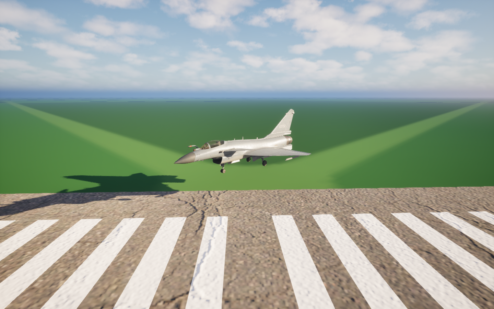
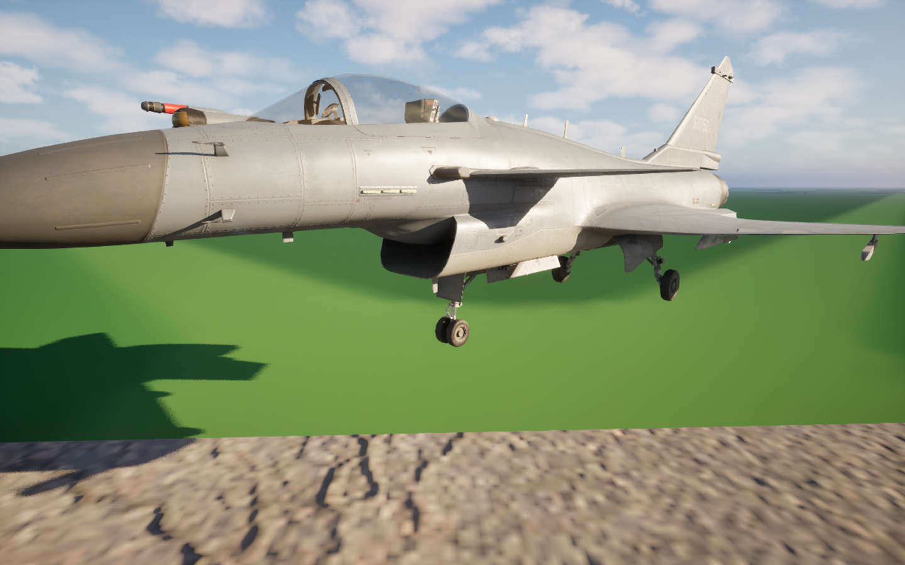

# J10CE 起落架固定标定姿态

更新：2026-10-28。本阶段仅验证收放与悬挂零位，创建可重复使用的固定姿态；轮胎接地点、眼点和质量基线尚未标定。

## 使用入口

将 `/Game/Blueprints/Pawns/Jets/J16CE/BP_J10CE_CalibrationPose` 拖入编辑器关卡。
它使用当前 `SK_Mesh_J10CE`、当前材质及独立 Animation Sequence，默认停止播放、禁止循环、播放位置与速率均为 0。
不包含 Fighter、输入、相机或 JSBSim 组件，不模拟物理，碰撞关闭。
默认 Mesh 相对变换为单位变换，后续坐标测量以 Mesh / 根组件局部厘米为基准；Actor 在场景中的摆放不代表 JSBSim 结构坐标。

固定片段：`/Game/Assets/Models/Jets/J10CE/Calibration/AN_J10CE_Calibration_GearDown_Unloaded`。
这是两个相同关键帧组成的绝对姿态，任意时间采样均保持同一姿态：

- 起落架完全展开，使用已修复收放路径的展开端。
- 前、左主、右主支柱均采用原作者工作零位，压缩输入分别为 0 cm。
- 前轮回正，轮胎滚动保持作者零位。
- 机身根节点和其余机构保持固定中立姿态。

这里的“零压缩”是卸载姿态，不是飞机承重停在地面时的姿态。截图中 Actor 被抬高以方便观察，不代表轮胎已经完成贴地标定。

## 本次新增资源

同一 `Calibration` 文件夹中还有：

| 资产 | 用途 |
|---|---|
| AN_J10CE_Gear_Deploy_Validated | 高精度展开验证片段，300 FPS |
| AN_J10CE_Gear_Retract_Validated | 高精度收起验证片段，300 FPS |
| AN_J10CE_Suspension_Nose_Validated | 前腿 0～14.05 cm 取姿 |
| AN_J10CE_Suspension_Left_Validated | 左主腿 0～17.45 cm 取姿 |
| AN_J10CE_Suspension_Right_Validated | 右主腿 0～17.45 cm 取姿 |
| BCS_J10CE_CalibrationPrecise | 此目录专用的 ACL Safe 压缩设置 |

行程沿用已交付美术机构的测量数据，不代表厂家公布的减震器参数。悬挂片段为绝对姿态，三条腿的零压缩端统一；单腿动作不会带动其他骨骼。
原导入动画、现有 ABP_J10CE、飞机蓝图与绑定资产在本轮均不覆盖，也未继续上轮暂停的其他动画工作。

## 为什么单独建立校准资源

当前原导入片段使用 30 FPS / Sequencer 动画数据模型，原验证源使用 300 FPS 和四元数数据模型。
实际对照发现：原收放片段某些驱动骨骼相对源数据约有 0.5° 偏差；悬挂零位的压缩取姿也有约 0.1° 偏差。
本次从已验证的修复曲线和悬挂工作零位生成新片段，不覆盖旧片段。

当前 Skeleton 的局部绑定参考与来源导入有小幅旋转差异。生成时以
`当前绑定参考 × 来源绑定参考的逆 × 来源姿态` 保留原动作的运动增量，适配当前 Mesh；不修改 Skeleton Reference Pose。

新增 `AircraftCalibrationTools` 为仅编辑器模块：只为本 Calibration 目录选择引擎原生四元数数据模型，
并通过引擎压缩保护与完整数据通知安全生成动画。它不参与每帧游戏逻辑，输出仍为标准 Animation Sequence。
后续编辑或重建这些校准资源时保留该工具；更新本地引擎构建后应随项目重新编译。

## 验证与范围

- AirCombatEditor Win64 Development 编译成功。
- 展开 / 收起分别对照 258 个源姿态，覆盖已知连杆分支变化区；检查原始和压缩数据，共 1032 次收放取姿。
- 三条悬挂零位逐值对照同一标定姿态；25% / 50% / 75% / 100% 采样验证其他骨骼保持不动。
- 固定片段在起点、中间和终点均一致；新的编辑器进程复开后再次通过。
- 预览蓝图直接放入场景即与固定片段一致，不依赖临时强制播放脚本；前轮轴向回正误差约 0.000014°。
- 原始 / 压缩收放取姿最大位置误差小于 0.0001 cm，最大旋转误差小于 0.00003°（相对适配后的已验证姿态）。
- 独立实际渲染检查完成。自动化及逐文件保护结果见 [validation.json](validation.json)。

本轮没有修改任何 JSBSim 参数、Skeleton 参考姿态或既有资产，没有展开其他动画，也没有写入或标定轮胎接地点 / EYEPOINT。
下一阶段可使用固定姿态进行几何测量，再统一转换到 Fighter Actor 和 JSBSim 结构坐标。

## 后续测量记录

2026-10-28：使用本固定姿态完成轮胎几何和三套坐标换算，见 [J10CE 几何测量](../J10CE_Geometry/README.md)。该次测量没有修改本姿态、XML 或 CG；人体眼点尚无定位依据，只提供座椅参照与预览候选。
