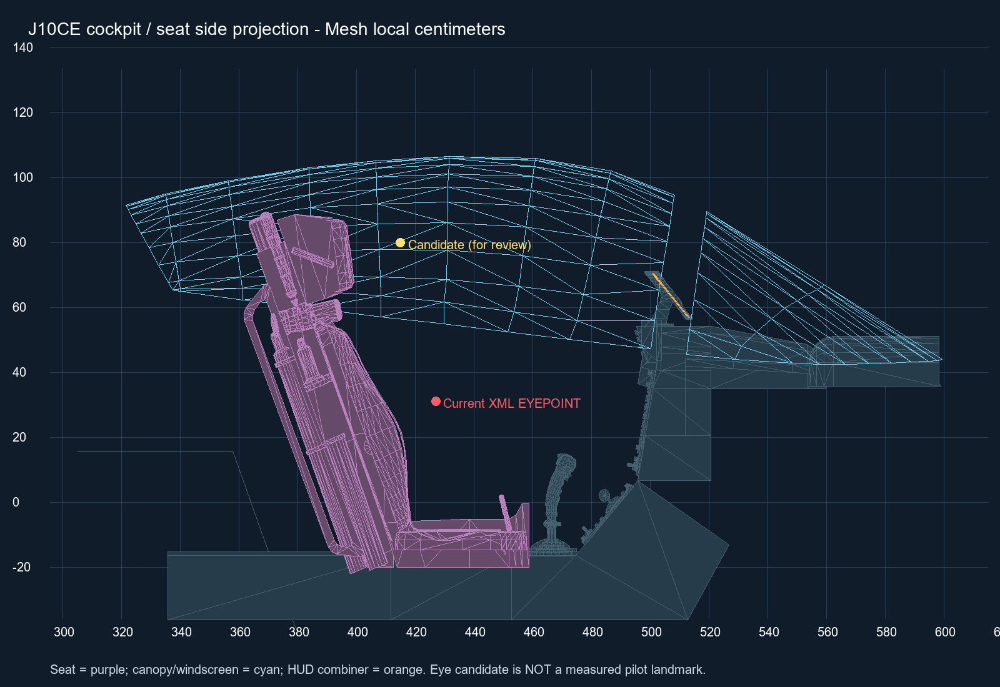
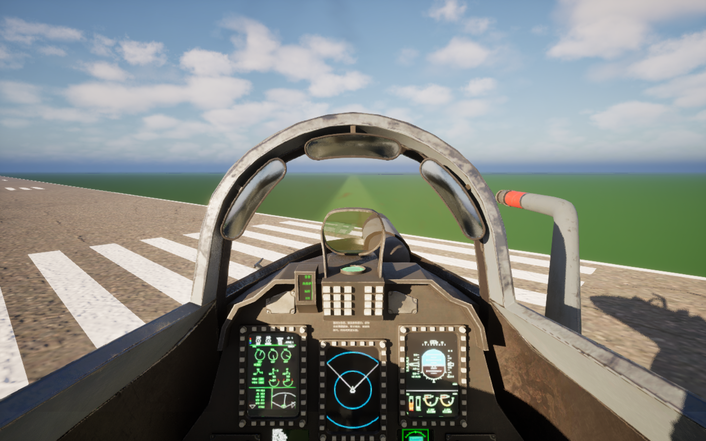

# J10CE 固定姿态几何测量与配置建议

测量日期：2026-10-28。状态：几何测量完成；随后已迁移为 Actor = Mesh 坐标。现已按测量值更新 XML 三个起落架接地点；动画、质量参数及 CG 未修改，相机在 Mesh 内的位置保持原值。

## 结论

三处起落架的轮心、未压缩接地基准和轮胎半径已从当前 Mesh 几何测得。前起落架是双轮，
因此“前 / 左主 / 右主”是三处起落架，共四条轮胎；本报告保留当前 XML 的三个 BOGEY 语义，另列前双轮的独立数据。
标定前 XML 的轴距和主轮距与 Mesh 不一致；目前三个接地点已按测量值更新，详见 [接地点标定](ContactCalibration/README.md)。

座舱有座椅与头枕，但当前 Mesh 组件的 socket / bone 列表没有飞行员、头部或眼点定位标记。
空座椅不能决定唯一的人体眼点。表中的座椅剖面基准是真实三角形交点；眼点只是供下一步审阅的视觉候选。
没有根据外形、轮位或座椅位置推算 CG，也没有调整空机 CG、载荷点、燃油位置、质量或惯性。

## 输入与坐标定义

- Mesh：`/Game/Assets/Models/Jets/J10CE/SK_Mesh_J10CE`，LOD0。
- 固定姿态：`/Game/Assets/Models/Jets/J10CE/Calibration/AN_J10CE_Calibration_GearDown_Unloaded`。
- 预览：`/Game/Blueprints/Pawns/Jets/J16CE/BP_J10CE_CalibrationPose`。直接生成后读取已经评估的组件姿态，没有用 Reference Pose 替代它。
- 当前飞行 Pawn：`/Game/Blueprints/Pawns/Jets/J16CE/BP_J16CE`，AircraftModel=`j10ce`。保留现有资源命名。
- **Mesh**：Airframe 组件空间，厘米，X 前 / Y 右 / Z 上。
- **Actor**：当前 Fighter 的静态基准局部空间，厘米，X 前 / Y 右 / Z 上。
  表中 Actor 不是无偏移预览蓝图 Actor 的坐标，也不是截图 Actor 被抬高后的世界坐标。
  PresentationRoot 按静态单位变换处理；高速时不能直接用最新物理 Actor 去比前一显示时刻的 Mesh。
- **JSBSim Structural**：XML 的结构参考系，英寸，X 后 / Y 右 / Z 上；不是以 CG 为原点的 Body 轴系。

当前配置已采用统一结构原点映射：Airframe 直接挂在 PresentationRoot 下，局部变换为单位变换。
VisualRoot 已删除；CockpitAnchor 和 ChaseFocus 均直接挂在 PresentationRoot 下，位置为 (10,0,0) cm，保留原 Mesh 内位置。
StructuralFrameOrigin=(-20,0,-40) cm，所有固定坐标为：

```text
Actor_cm = Mesh_cm
Structural_in = (-(Actor.X+20), Actor.Y, Actor.Z+40) / 2.54
Actor_cm = (-Structural.X, Structural.Y, Structural.Z) * 2.54 + (-20,0,-40)
```

本轮归一化没有更改 Mesh、固定姿态或 XML，所以 Mesh 测量值与 JSBSim 结构坐标不变。
Actor 坐标列重新表达为 Mesh 坐标；原始组件快照保留在 measurement_source_metadata.json。

## 测量方法和接地点定义

编辑器工具 `AircraftCalibrationLibrary.ExportCalibrationGeometry` 读取导入 LOD0 顶点、反绑定矩阵和当前已评估的骨骼变换，
按蒙皮权重计算 Mesh 空间几何。只写测量 JSON，不保存或修改输入 Mesh / Skeleton / Animation / Blueprint。
本次共 55,510 个 LOD 顶点、63,470 个三角形。

轮胎顶点均为对应 wheel bone 的 100% 刚性权重。去重后前轮组 1202 点，两侧主轮各 601 点。
轴线与 Mesh Y 的最大夹角约 0.00003433°，可用 XZ 轮廓拟合圆。
轮心的 X/Z 来自外轮廓凸包圆拟合；Y 取外胎最高半径带的两侧中面，避免被内侧轮毂突出部分和骨骼枢轴误导。
拟合残差最大约 0.000017 cm，只反映该数字几何的圆度，不代表真机测量精度。

**接地基准**指固定姿态、未压缩、机体轴线水平时，胎面最低 Z 支撑集合的中点，Z 取实际最低值。
这是无载几何接地基准，不是承重压扁后的接触斑、动态地形接触点或压缩后的轮位。
表中前轮组“等效接地点”位于两条胎的中间，不在真实橡胶表面上；用来对应当前单个 NOSE_GEAR BOGEY。
前左 / 前右的独立接地点才是各自真实胎面的几何基准。

## 三套坐标对应表

显示保留两位小数；[coordinates.csv](coordinates.csv) 和 [measurements.json](measurements.json) 保留未四舍五入值。

| 点 | Mesh 局部 cm | Fighter Actor 局部 cm | JSBSim Structural in |
|---|---|---|---|
| 前轮组等效轮心 | (331.22, 0.00, -210.80) | (331.22, 0.00, -210.80) | (-138.28, 0.00, -67.25) |
| 前轮组等效接地基准 | (331.22, 0.00, -230.32) | (331.22, 0.00, -230.32) | (-138.28, 0.00, -74.93) |
| 左主轮轮心 | (-147.07, -120.81, -200.09) | (-147.07, -120.81, -200.09) | (50.03, -47.56, -63.03) |
| 左主轮接地基准 | (-147.07, -120.81, -230.75) | (-147.07, -120.81, -230.75) | (50.03, -47.56, -75.10) |
| 右主轮轮心 | (-147.07, 120.81, -200.09) | (-147.07, 120.81, -200.09) | (50.03, 47.56, -63.03) |
| 右主轮接地基准 | (-147.07, 120.81, -230.75) | (-147.07, 120.81, -230.75) | (50.03, 47.56, -75.10) |
| 前左轮胎轮心 | (331.22, -10.97, -210.80) | (331.22, -10.97, -210.80) | (-138.28, -4.32, -67.25) |
| 前左轮胎接地基准 | (331.22, -10.97, -230.32) | (331.22, -10.97, -230.32) | (-138.28, -4.32, -74.93) |
| 前右轮胎轮心 | (331.22, 10.97, -210.80) | (331.22, 10.97, -210.80) | (-138.28, 4.32, -67.25) |
| 前右轮胎接地基准 | (331.22, 10.97, -230.32) | (331.22, 10.97, -230.32) | (-138.28, 4.32, -74.93) |
| 座椅/头枕前表面剖面基准（Z=80） | (396.13, 0.00, 80.00) | (396.13, 0.00, 80.00) | (-163.83, 0.00, 47.24) |
| 眼点候选，非实测 | (415.00, 0.00, 80.00) | (415.00, 0.00, 80.00) | (-171.26, 0.00, 47.24) |
| 当前座舱相机默认位置 | (10.00, 0.00, 0.00) | (10.00, 0.00, 0.00) | (-11.81, 0.00, 15.75) |
| 当前 XML EYEPOINT | (427.04, 0.00, 31.12) | (427.04, 0.00, 31.12) | (-176.00, 0.00, 28.00) |

## 轮胎尺寸与姿态

| 轮胎 | 未压缩几何半径 cm | 直径 cm |
|---|---:|---:|
| 前左轮胎 | 19.5202 | 39.0404 |
| 前右轮胎 | 19.5202 | 39.0404 |
| 左主轮 | 30.6629 | 61.3257 |
| 右主轮 | 30.6628 | 61.3257 |

前轮滚动半径建议采用 19.5202 cm，左右主轮采用 30.6629 cm，作为后续 `WheelRadiusCm` 的 Mesh 几何基准。
当前没有改动画绑定。该值不是承重有效滚动半径，也无需将半径重复添加到 BOGEY 的接地点 Z。
当前 JSBSim 接触实现直接用未压缩接触点高度求压缩，不会自动替这个位置再减一次轮胎半径。

- 前轮组至主轮中点的轴距：**478.2942 cm**。
- 主轮接触中线轮距：**241.6130 cm**。
- 前双轮中心距：约 21.9439 cm。
- 前轮最低点比两主轮高 **0.4314 cm**；保持该几何差异，不能为让表格同高而单独篡改一条腿的零位。
  若不考虑承重压缩，三点在同一水平地面上对应机体约 **0.0517° 低头**。实际静置姿态还取决于各腿受载和支柱压缩。
- 主轮骨骼枢轴相对胎面中面的横向偏差约 **12.1158 cm**。
  左主轮 pivot Y=-108.6910，胎面中面 Y=-120.8067；右侧对应 +108.6905 与 +120.8063。
  因此不能用 wheel bone translation 直接作为主轮几何轮心。

## 与标定前 XML 对照（历史差值）

下表保留标定前 XML 的差值；2026-10-28 已将下文镜像取整值写入 XML。差值方向为 `实测接地点 Actor - 标定前 XML 接地点 Actor`。

| BOGEY | 现有 Structural in | Mesh 换算结果 Structural in | 差值 Actor cm |
|---|---|---|---|
| NOSE_GEAR | (-178.0000, 0.0000, -76.0000) | (-138.2766, 0.0000, -74.9303) | (-100.90, 0.00, 2.72) |
| LEFT_GEAR | (48.0000, -55.0000, -75.0000) | (50.0283, -47.5617, -75.1002) | (-5.15, 18.89, -0.25) |
| RIGHT_GEAR | (48.0000, 55.0000, -75.0000) | (50.0283, 47.5615, -75.1002) | (-5.15, -18.89, -0.25) |

标定前 XML 轴距为 574.0400 cm、主轮距为 279.4000 cm，分别比 Mesh 大约 **95.7458 cm** 和 **37.7870 cm**。
前接地点纵向差约 100.90 cm，而两侧主轮纵向差约 5.15 cm；主轮横向也各相差约 18.89 cm。
改变一个整体偏移不能消除这些差值。

现已保留 StructuralFrameOrigin=(-20,0,-40) 与 Airframe 单位变换，
仅将三个 BOGEY 的 location 更新为对应接地基准。
主轮极小的左右不对称来自已有几何和浮点取姿，约 0.0004 cm；配置可使用镜像取整值：

```text
NOSE_GEAR  (-138.2766,   0.0000, -74.9303) in
LEFT_GEAR  (  50.0283, -47.5616, -75.1002) in
RIGHT_GEAR (  50.0283,  47.5616, -75.1002) in
```

保留前轮组单 BOGEY，在当前测试阶段无需为双轮增加第四个物理接触单元。
未来如需要分轮触地、前双轮越障或独立载荷，再单独讨论接触模型。
本方案不顺带调整弹簧、阻尼、摩擦、转向、CG、载荷点、惯性、气动、发动机或控制系统。
已补做地面配平与短时承重检查；悬挂动画和完整飞行包线仍需后续独立验证。

## 座舱眼点：可测基准与待定候选

座椅材质段 `MSlot_Material__27` 的 Mesh 包围范围为 X=361.8023～458.7502、
Y=-30.6991～30.6962、Z=-22.0813～89.3809 cm。
在明确选定的中心剖面 **Y=0、Z=80 cm** 上，沿 X 射线与座椅/头枕三角形求交，
最前方表面 X=**396.129514 cm**。这只是一处可复现的几何参照，并非人体眼位。

视觉候选取 **Mesh (415,0,80) cm**，位于该剖面前方约 18.87 cm。
它对应 Actor **(415,0,80) cm**、Structural **(-171.2598,0,47.2441) in**。
这是基于座椅布局选择并做过视野检查的预览候选，没有飞行员模型、眼点 locator 或人体尺寸依据，不能标注为“已实测眼点”。
下一步应先用飞行员/头部代理和 HUD 视线确认该值，或者由作者明确接受一个游戏视点，再同步座舱锚点与 XML EYEPOINT。

当前 XML EYEPOINT 是 Mesh (427.04,0,31.12) cm，明显低于这个候选；
当前 CockpitCamera 默认位置是 Mesh (10,0,0) cm，也尚未放到驾驶舱。
当前架构里 XML EYEPOINT 不会自动驱动座舱相机，需要显式分别设置。

如果下一步采用上述候选，CockpitAnchor 直接挂在 PresentationRoot 下，局部位置填写 **(415,0,80) cm**，
CockpitCamera 自身局部位置保持零，XML EYEPOINT 再按表换算。当前仍为 (10,0,0)，本次没有应用候选值。
模型轴向和尺寸由导入规范保证，UE 组件不再保存标定旋转或缩放。





候选视野图：固定姿态被临时放置于世界 Z=500 cm，观察点为 Mesh (415,0,80)，编辑器俯仰 -8°。
该图仅检查视野和穿模，使用编辑器视口设置，不代表已修改游戏相机 FOV / 旋转。
另有 [座椅外部检查图](cockpit_seat_view.png)。截图的世界抬高量没有参与坐标换算。

## 原始测量阶段验证及保存范围

- 新增只读几何导出接口后，AirCombatEditor Win64 Development 完整编译成功。
- 本次生成组件姿态逐骨骼对照固定标定源：123 根，最大位置差 0.0000152588 cm，
  最大旋转差 0.0000088727°。
- 顶点索引完整，三个 wheel bone 上的轮胎顶点均为刚性权重；前轮和两主轮轴线均与 Y 对齐。
- 三套坐标往返误差 < 0.000000001 cm；座椅剖面使用真实三角形求交。
- 新进程离屏渲染两处检查通过；所有临时 Actor 均未保存。
- 测量前后逐文件 SHA-256 检查：**688 个** Content / Config / Source / JSBSim 资源无新增、删除或变化。
  XML、现有蓝图、标定姿态与其他动画、飞行 / 相机配置均未改动。
- 仅编辑器插件增加读出接口，本目录新增报告与数据；没有继续暂停的动画系统改造。
- 本阶段没有载荷求解或 CG 标定。CG 需要独立质量分布依据；轮胎和座椅几何不能替代它。

数据：[完整轮胎测量](measurements.json)、[眼点状态](eye.json)、[坐标 CSV](coordinates.csv)、
[组件变换与姿态快照](metadata.json)、[XML 差值](xml_comparison.json)、[验证与输入哈希](validation.json)。

## 结构原点迁移后的验证

上文“688 个文件无变化”的检查是原始只读测量阶段的历史记录，见 [measurement_validation.json](measurement_validation.json)。
本次蓝图和出生点坐标迁移的最新验证见 [统一结构原点验证](../StructuralOrigin/validation.json)。
在此前的结构原点迁移阶段，几何和 XML 坐标未改变，只更新 Actor 列；接触点在随后阶段应用，见下节。眼点和 CG 未修改。


## 接地点已写入 XML

2026-10-28：三个接地点已应用，空机 CG=(0,0,0) 的模型约定保留，未从 Mesh 推算 CG。
原测量坐标表不变；实际取整值、地面/空中验证及已发现的空中支柱力遥测问题见 [ContactCalibration](ContactCalibration/README.md)。
眼点候选和其他质量、气动、飞控参数仍未修改。


## 空中支柱力遥测已修复

收起冷启动的异常力已在 UE 遥测适配层隔离并通过收放与重载验证，见 [Telemetry](../../FlightDynamics/Telemetry/README.md)。
该修复没有改变本页几何测量值、XML 接地点或气动/飞控参数。
